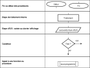
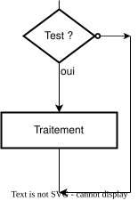
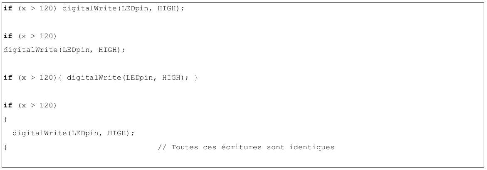
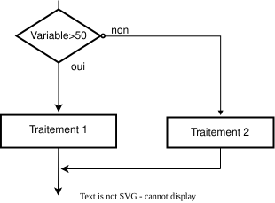
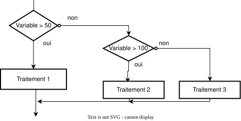
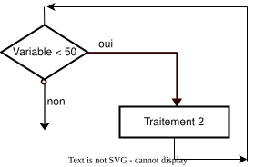
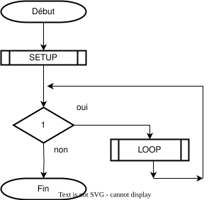

## Les variables

Les variables sont utilisées pour stocker temporairement une valeur ou un état à l'intérieur d'un programme. En C++ elles doivent être déclarées avant l'initialisation. Lors de la déclaration, on peut l'initialiser ou non :

```cpp
int Variable1; 
int Variable2 = 0;  // Initialisation à la valeur 0
```

L'opérateur = réalise une affectation. Dans l'exemple ci-dessus Variable2 est affectée à la valeur 0.

## L'organigramme

Pour décrire le comportement global d'un programme, un organigramme peut-être utilisé. Il est composé de symboles particuliers que l'on relie. Le sens de lecture conventionnel est de haut en bas ou de gauche à droite. Lorsque le sens ainsi défini n'est pas respecté, il est nécessaire de flécher.



## Les structures de contrôle :

Les structures de contrôle sont des blocs d'instructions qui s'exécutent en fonction du respect d'un certain nombre de conditions. En C++ le **if** réalise un test sur une variable ou le résultat d'une opération. Si ce test est vérifié on exécute un code particulier sinon on passe au code suivant. En C++, le **if** s'écrit :

```cpp
if(Variable> 50) // Test ? si variable > 50 
{    // alors on fait le 
    //  Traitement entre accolades
}
```



Dans l'exemple ci-dessus, le traitement est effectué si la variable est supérieure à 50. Les accolades peuvent être omises. Si c'est le cas seule l'instruction qui suivra sera exécutée de manière conditionnelle. L'exemple suivant montre des écritures identiques :



Pour tester deux variables il existe en C++ un nombre important d'opérateurs de comparaison:

- x == y : x est égale à y
- x != y : x n'est pas égal à y
- x &lt; y  :x est inférieur à y
- x > y  : x est supérieur à y
- x &lt;= y  : x est inférieur ou égal à y
- x >= y : x est supérieur ou égal à y

<!-- zone: 2 -->

la combinaison **if/else** est également possible : elle permet la programmation de deux traitements différents selon un test :

```cpp
if(Variable>50)
{
  //Traitement 1
}
else
{
  //Traitment 2
}
```



```cpp
if(Variable>50)
{
  //Traitement 1
}
else if(Variable>100)
{
  //Traitment 2
}
else
{
  // Traitement 3
}
```



/home/paul/NextcloudEdu/Progression STI2D/Site_web/alogo_if3.svg

!!! warning "== et = !"
    Ne pas confondre l'opérateur == qui compare si deux variables sont identiques et l'opérateur = d'affectation.

    x=4 ; // la nouvelle valeur de x est 4 (NB : en Pascal : x  := 4 ;)

    if (x==4) ; // Test si x est égal à 4

## Boucle Tant que ... Faire :

La boucle **while** permet d'exécuter des instructions jusqu'à ce qu'une certaine expression (à l'intérieur de la parenthèse) devienne fausse. Autrement dit, tant que le test est vérifié, on répète les instructions entre accolade :

```cpp
while(Var < 50)//
{
  // Traitement
}
```



!!! reminder "Structure basique d'un programme Arduino"
    Un programme Arduino doit être composé au minimum de deux fonctions :

    ✗ **setup ()** : Dans la quelle les variables, le sens des broche d'E/S, les librairies spécifiques sont initialisés.

    Cette fonction est appelée une seule fois au démarrage ou lors d'un RESET de la carte Arduino.

    ✗ **loop ()** : La fonction loop comme son nom l'indique boucle indéfiniment. C'est dans cette boucle que se

    trouve le coeur du programme qui contrôlera les E/S de la carte.

    Ce qui peut être décrit par l'algorithme suivant :

    

    ```cpp
    void setup() {

      // Code execute une fois

    }

    // boucle infini
    void loop()
    {
      // Traitement repete indefiniement 
    }
    ```
