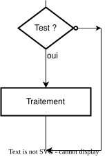
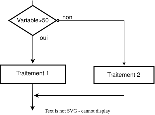
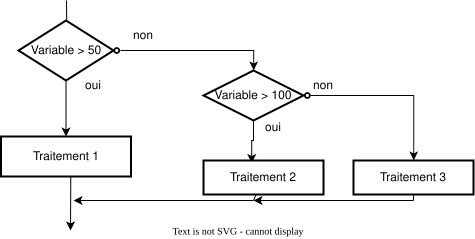
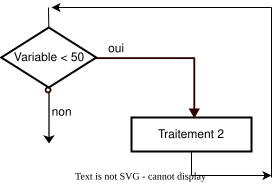
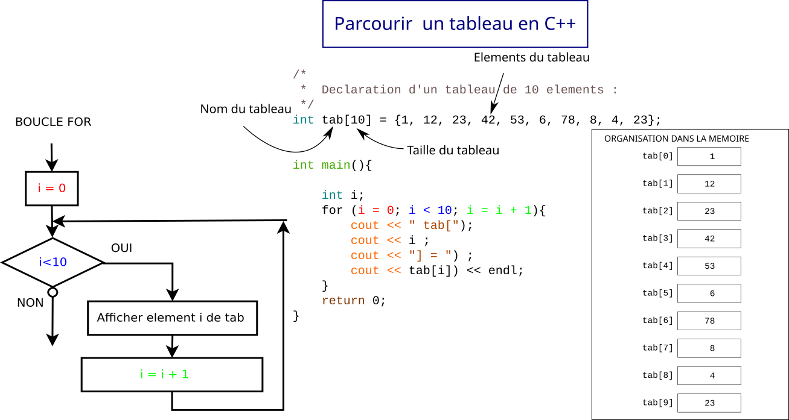
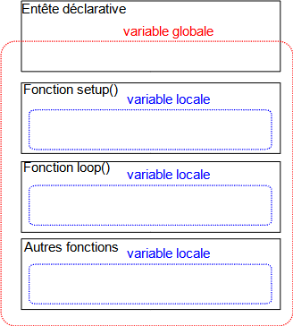

## Les types des variables en C++

Les variables sont utilisées pour stocker temporairement une valeur ou un état à l'intérieur d'un programme. En C++ elles doivent être déclarées avant l'initialisation. Lors de la déclaration, on peut l'initialiser ou non :

```cpp
int Variable1;
int Variable2 = 0;     // Initialisation
```

L'opérateur = réalise une affectation. Dans l'exemple ci-dessus Variable2 est affectée à la valeur 0.

Lors de la **déclaration**, le **type** de variable doit être spécifié. Il existe différents types de variables identifiés par un mot-clé dont les principaux sont :

Le tableau montre les différents type et l’espace qu’ils occupent dépend de l’architecture (8, 16, 32, ou 64 bits). Ici pour une architecture 64 bits :

| **Types** | **Nombre d’octet** |   |
|---|---|---|
| bool | 4 | Deux états possibles : True/False |
| char | 1 | -127 &lt;N &lt; +127. |
| unsigned char | 1 | 0 &lt; N &lt; 255 |
| byte | 1 | 0 &lt; N &lt; 255 |
| int | 4 | −2 147 483 648 &lt;N&lt; 2 147 483 647 |
| unsigned int | 4 | 0 &lt; N &lt; 4 294 967 295 |
| long | 8 |   |
| unsigned long | 8 |   |
| float | 4 |   |
| double | 8 |   |

Le programmeur en pratique utilisera principalement **int**, **float** et **char** et si les données sont plus étendues il tentera d'autre types plus étendus.

## Les constantes

Il peut être utile de déclarer des constantes pour améliorer la lisibilité et l'évolutivité d'un programme.

```cpp
const int LED = 3 // La LED est sur la broche 3
```

Cette déclaration garantit que la variable LED ne changera pas de valeur.

<!-- zone: 4 -->

## Les structures de contrôle :

Les structures de contrôle sont des blocs d'instructions qui s'exécutent en fonction du respect d'un certain nombre de conditions. En C++ le **if** réalise un test sur une variable ou le résultat d'une opération. Si ce test est vérifié on exécute un code particulier sinon on passe au code suivant. En C++, le **if** s'écrit :

```cpp
if(Variable> 50) // Test ? si variable > 50 
{    // alors on fait le 
    //  Traitement entre accolades
}
```



Dans l'exemple ci-dessus, le traitement est effectué si la variable est supérieure à 50. Les accolades peuvent être omises. Si c'est le cas seule l'instruction qui suivra sera exécutée de manière conditionnelle. L'exemple suivant montre des écritures identiques :


Pour tester deux variables il existe en C++ un nombre important d'opérateurs de comparaison:

- x == y : x est égale à y
- x != y : x n'est pas égal à y
- x &lt; y  :x est inférieur à y
- x > y  : x est supérieur à y
- x &lt;= y  : x est inférieur ou égal à y
- x >= y : x est supérieur ou égal à y

la combinaison **if/else** est également possible : elle permet la programmation de deux traitements différents selon un test :

```cpp
if(Variable>50)
{
  //Traitement 1
}
else
{
  //Traitment 2
}
```



l est possible de rajouter autant de branches que l'on veut de cette manière.

```cpp
if(Variable>50)
{
  //Traitement 1
}
else if(Variable>100)
{
  //Traitment 2
}
else
{
  // Traitement 3
}
```



!!! warning "== et = !"
    Ne pas confondre l'opérateur == qui compare si deux variables sont identiques et l'opérateur = d'affectation.

    x=4 ; // la nouvelle valeur de x est 4 (NB : en Pascal : x  := 4 ;)

    if (x==4) ; // Test si x est égal à 4

!!! info
    <!-- zone: 4 -->

## Boucles

La boucle **while** permet d'exécuter des instructions jusqu'à ce qu'une certaine expression (à l'intérieur de la parenthèse) devienne fausse. Autrement dit, tant que le test est vérifié, on répète les instructions entre accolade :

La boucle **while** permet d'exécuter des instructions jusqu'à ce qu'une certaine expression (à l'intérieur de la parenthèse) devienne fausse. Autrement dit, tant que le test est vérifié, on répète les instructions entre accolade :

```cpp
while(Var < 50)//
{
  // Traitement
}
```



La boucle for :


L’instruction **break** permet de sortir de n’importe quelle boucle :

```cpp
    while(true){
        if(Var > 50){
            break;     // Sortir de la boucle si Var est supérieur à 50
        }
    }
```

## Les tableaux

Wikipedia sur les [https://fr.wikibooks.org/wiki/Programmation_C%2B%2B/Les_tableaux](https://fr.wikibooks.org/wiki/Programmation_C%2B%2B/Les_tableaux) :" Les tableaux sont des structures de données constituées d'un certain nombre d'éléments de même type. On peut accéder directement à un élément du tableau en indiquant son indice entre crochets (indice de 0 à nombre_d_éléments-1)."

Synthaxe :


**Sémantique**

`identificateur` est donc un tableau de `taille` éléments de type `type`. `taille` est obligatoirement une valeur constante. La taille du tableau est donc figée une fois pour toute et ne peut pas être modifiée en cours d'exécution.

Pour désigner la **i-ième** case de tableau, on écrit

**identificateur\[i\]**

où i est un entier quelconque. Les cases sont numérotées à partir de 0 : les valeurs possibles de i vont donc de 0 à taille-1.



## Les fonctions

Une fonction (également désignée sous le nom de procédure ou de sous-routine) est un bloc d'instructions que l'on peut appeler à tout endroit du programme. La bibliothèque Arduino est constituée d'un certain nombre de fonctions, par exemple **analogRead(), digitalWrite()** ou **delay()**. Il est possible de déclarer ses propres fonctions par exemple :


Tout ce qui se trouve entre accolades fait parti de la fonction clignote. Pour exécuter cette fonction, il suffit de taper la commande **clignote();**

## Paramètres d'entrée

On peut faire intervenir un ou des paramètres en entrée dans une fonction :


La fonction clignote comporte 2 paramètres d'entrée : broche et vitesse. Le types des paramètres d'entrée doivent être définis, ici se sont des **int**.

Dans ce cas, on peut moduler leurs valeurs depuis la commande qui l'appelle :


## Paramètres de sortie

On peut faire intervenir un paramètres en sortie également dans une fonction :


La fonction addition comporte 2 paramètres d'entrée **a** et **b** qui sont des entiers (**int**). **r** représente le résultat de la fonction addition. Sa valeur est retournée par la fonction.

L'utilisation dans un programme peut être ainsi :

```cpp
int s = addition(3,2);
```

Le type **void** en C et en C++ est l'équivalent de l'ensemble vide. Lorsqu'une fonction ne renvoie aucun argument (pas de **return**) alors on déclare un type **void** comme paramètre de sortie, pour dire qu'elle ne renvoie rien. C'est le cas des fonction **loop** et **setup()** :

## Portée d'une variable (globale ou locale)

On appelle **variable globale**, une variable qui peut être vue dans toutes les fonctions du programme. Les **variables locales** elles, ne sont visibles que dans la fonction où elles sont déclarées. Dans l'environnement Arduino, toutes variables déclarées en dehors des fonctions (loop (), setup(), …) sont des variables globales.

```cpp
int MaVariableGlobale;  // Toutes les variables voient  MaVariable

void setup()
{
  // ...
}
void loop()
{
  int i;    // i n'est visible que dans la fonction loop
  float f;  // f n'est visible que dans la fonction loop
  // ...

  for (int j = 0; j <100; j++){
  // j n'est visible que dans la boucle for
  }
}
```



## Passage par référence

Lorsque l'on souhaite modifier une valeur d'une variable en entrée :

```cpp
/////////////////////////////////////////////////////
// Cette fonction met la valeur de n a 0
void annule(int &n)
{
    n=0;
}
```

Lors de son appel la variable entre parenthèse sera =0.
