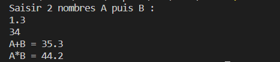
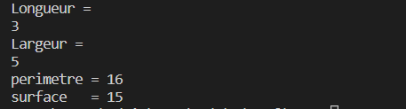
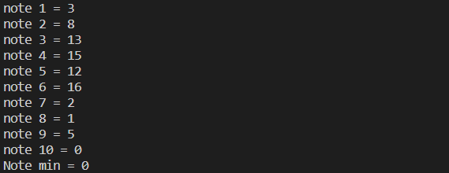
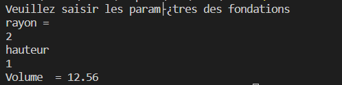

## Introduction

Chaque programme doit comporter la structure suivante :

```cpp
#include <iostream>  
using namespace std; 

int main() 
{
    // Partie a completee
    
    return 0;                          // 0 si succes de la fonction
}
```

!!! consigne
    Créer un projet ou dossier par exercice. Chaque projet doit être contenu dans un dossier nommé à votre **Nom**. A la fin de l'évaluation ce dossier est à copier dans **restitution de devoir**.

## Ex1

L'utilisateur est invité à saisir 2 nombres à virgule le programme  affiche la somme au terminal puis le programme affiche le produit



## Ex2

L'utilisateur est invité à saisir 2 nombres : La longueur et la largeur d'un rectangle. Le programme affiche la surface et le périmètre.



## Ex3

L'utilisateur est invité à saisir 10 notes entre 0 et 20. Le programme calcule et affiche le minimum de ses 10 notes.

**Aide** : Utiliser une boucle for pour la saisie des notes. Pour chaque saisie la note est comparée à une variable Min initialisée à 20. Si la note saisie est inférieur à Min on met à jour Min (Min = note ).



## Ex4

L'utilisateur est invité à saisir 10 notes entre 0 et 20. Le programme calcule et affiche le maximum de ses 10 notes.

## Ex5

Le programme affiche : Veuillez saisir les parametres des fondations. L'utilisateur saisit le rayon et la hauteur et le programme calcule et affiche le volume du cylindre.

Attention : Le programme doit comporter 2 fonctions  :

```cpp
#include <iostream>  
using namespace std; 
void affichage_debut(void);
float volume_fondation(float r, float h);

int main() 
{
    float r;
    float h;
    float v;
    affichage_debut();
   
    return 0;                          // 0 si succes de la fonction
}
void affichage_debut(void){

   // A Compléter
}
float volume_fondation(float r, float h)
{
// A Compléter
}
```

affichage_debut() affiche « Veuillez saisir les parametres des fondations » la seconde volume_fondation calcul le volume du cylindre de rayon r et de hauteur h. Le programme est à compléter ici et doit afficher :



## solutions

### Ex3

```cpp
/* 
Eval Ex3
Calculer le min

*/
#include <iostream>  // pour utiliser cout et cin
using namespace std; // pour alléger l'ecrtiture

int main() // Fonction pricipale exécutee en premier
{
    int N = 10;
    float min = 20.0;
    int i;
    float note = 0.0;

    for(i=0; i < N; i = i + 1) // Pour toutes les valeur de 0 à N-1
    {
        cout<<"Note "<< i + 1<<endl;
        cin>>note;
        if(note < min)
        {
            min = note;
        }
    }
    cout<<"Min = "<<min<<endl;
    

    return 0;                          // 0 si succes de la fonction
}
```

### Ex4

```cpp
/* 
Eval Ex4
Calculer le min

*/
#include <iostream>  // pour utiliser cout et cin
using namespace std; // pour alléger l'ecrtiture

int main() // Fonction pricipale exécutee en premier
{
    int N = 10;
    float max = 0.0;
    int i;
    float note = 0.0;

    for(i=0; i < N; i = i + 1) // Pour toutes les valeur de 0 à N-1
    {
        cout<<"Note "<< i + 1<<endl;
        cin>>note;
        if(note > max)
        {
            max = note;
        }
    }
    cout<<"Min = "<<max<<endl;
    

    return 0;                          // 0 si succes de la fonction
}
```
