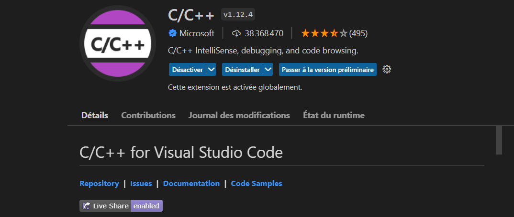
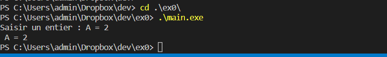

## Premier programme

Le langage C++ est le langage utilisé dans beaucoup de domaine, et c'est le langage utilisé pour programmer dans l'environnement Arduino. Nous allons ici utiliser le logiciel Visual Studio Code et l'extension C/C++.



!!! consigne
    Pour chaque exercice on crée un répertoire nommé ici ex0 et on crée le fichier main.cpp qui contient le programme.

Paramétrage de VS Code :


!!! consigne
    Depuis le réseau local faire un copier-coller du répertoire **dev** dans votre espace personnel.

Une fois l'environnement correctement configuré le premier programme à tester est celui-ci :

```cpp
/* 
    Utilisation de cin et cout 

L'utilisateur saisit 1 nombre
entier et le programme l'affiche

*/
#include <iostream>  // pour utiliser cout et cin
using namespace std; // pour alléger l'ecrtiture

int main() // Fonction pricipale exécutee en premier
{
    int A;
    cout << "Saisir un entier : A = "; // Affichage de la chaine de caractere
    cin >> A;                          // Recupere la valeur de A
    cout <<" A = " << A << endl;       // Affiche la valeur de A 
                                       // endl permet un retour a la ligne
    
    return 0;                          // 0 si succes de la fonction
}
```

!!! consigne
    Compiler le programme : Pour compiler Il faut lancer un nouveau terminal.

Compilation du programme sous VS Code :


Une fois compilé, le compilateur génère un fichier appelé ex__.exe que l'on peut exécuter depuis le terminal :

!!! consigne
    Exécuter le programme à partir du terminal en se plaçant au préalable dans le répertoire de travail :



## Exercices

!!! consigne
    **Ex1** : A l'aide de cin et cout : L'utilisateur saisit 2 nombres entiers et le programme affiche A + B = résultat

!!! consigne
    **Ex2** :A l'aide de cin et cout : L'utilisateur saisit le rayon d'un disque  et le programme calcul et affiche sont périmètre et sa surface

!!! consigne
    **Ex3** : l'utilisateur saisi un nombre entier et le programme affiche son signe, et sa parité.

!!! consigne
    **Ex4** : L'utilisateur saisi le nombre d'étoile qu'il souhaite afficher. Et le programme affiche en ligne les étoiles en lignes avec un retour à la ligne après la dernière étoile. Utiliser une boucle while.

!!! consigne
    **Ex5** : (boucle while imbriquées) l'utilisateur saisi le nombre de lignes qu'il souhaite afficher et le programme affiche une étoile puis 2 puis 3 etc.

!!! consigne
    **Ex6** : L'utilisateur saisi le nombre d'étoile qu'il souhaite afficher. Et le programme affiche en ligne les étoiles en lignes avec un retour à la ligne après la dernière étoile. Utiliser une boucle for

!!! consigne
    **Ex7** : (boucle for imbriquées) l'utilisateur saisi le nombre de lignes qu'il souhaite afficher et le programme affiche une étoile puis 2 puis 3 etc.

!!! consigne
    **Ex8** : Moyenne des notes : L'utilisateur saisi le nombre de note qu'il souhaite saisir puis il saisi les notes. A chaque saisie, le programme met à jour la somme des notes, calcule la moyenne et l'affiche

!!! consigne
    **Ex9** : Les tableaux. Afficher le contenu des tableaux ci-dessous

```cpp
    const int N = 10; // Taille des tableaux
    int tab1[N] = {2,3,4,6,21,-5, 3,4,0,1}; // Tableau de 10 éléments initialisé
    int tab2[N] = {0}; // Tous les éléments sont nuls  
    float notes[N] = {0.0}; // Tableau de float
```

!!! consigne
    Ex10 : Calculer  et afficher la moyenne des 10 notes d'un tableau préalablement saisies par l'utilisateur.

!!! consigne
    **Ex11** : Les fonctions : Implémenter 4 fonctions telles que

    void afficher_bienvenue(void)

    void afficher_N_etoiles(int N)

    int  addition(int a, int b)

    float perimetre(float r)

On les déclarera ainsi juste avant le main(void) :

```cpp
/////////////////////////////////////////////////////
// DECLARATION DES PROTOTYPES
/*
Cette fonction affiche juste "Bienvenue"  au terminal
*/
void afficher_bienvenue(void);
/*
Cette fonction affiche N etoile au terminal
*/
void afficher_N_etoiles(int N);
/*
Cette fonction realise l'addition de a et b et affiche le resultat au terminal
*/
 int  addition(int a, int b);

/*
Cette fonction renvoie la valeur du permietre d'un cercle de rayon r
*/ 
float perimetre(float r)
```

!!! consigne
    **Ex12** : Les fonctions : Réaliser une fonction void incrementer(int &n) qui ajoute 1 à la variable n

!!! consigne
    **Ex13** : Implémenter une flonction setup et une fonction loop à la manière Arduino et les appeler convenablement dans main()
