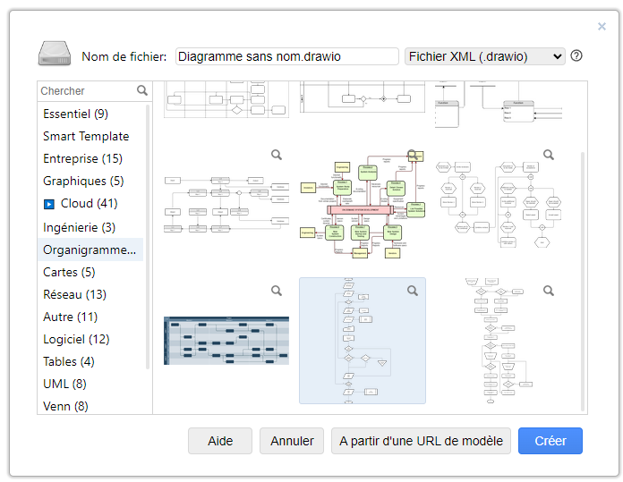

## Jeu de loi

**Exercice : Le jeu de l'oie simplifié**

Dans ce projet, vous allez réaliser une version simplifiée du jeu de l'oie pour un joueur.

**Description :**

Le jeu de l'oie est un jeu de plateau où les joueurs déplacent leurs pions sur un parcours linéaire en fonction des jets de dés. Le but est d'arriver à la fin du parcours.

Pour ce projet, le parcours est composé de 63 cases. Certaines de ces cases ont des effets spéciaux :

- Case 6 : Pont - Avancez directement à la case 12.
- Case 19 : Auberge - Sautez le prochain tour.
- Case 31 : Puits - Attendez de lancer un 6 pour pouvoir continuer.
- Case 42 : Labyrinthe - Retournez à la case 30.
- Case 52 : Prison - Attendez de lancer un 6 pour pouvoir continuer.
- Case 58 : Mort - Retournez à la case 1.

**Instructions :**

1. Affichez un message d'accueil pour le jeu.
2. Tant que le joueur n'a pas atteint ou dépassé la case 63, il continue à jouer.
3. Le joueur lance un dé (valeurs de 1 à 6) à chaque tour.
4. Après chaque lancer, le joueur avance du nombre de cases correspondant au résultat du dé.
5. Si le joueur atterrit sur une case spéciale, appliquez l'effet de cette case.
6. Lorsque le joueur atteint la case 63, affichez un message de félicitations.

**Conseils :**

- Utilisez une boucle pour le déroulement du jeu.
- Gérez les cases spéciales à l'aide d'une fonction ou d'une série de conditions.
- Pour simuler le lancer de dé, utilisez la fonction \`rand()\` de la bibliothèque \`&lt;cstdlib>\`.

!!! consigne
    Vous devez impérativement faire un algorigramme à l'aide du logiciel en ligne [https://app.diagrams.net/](https://app.diagrams.net/)



!!! consigne
    L'originalité de la solution sera noté, le copier/collé (ou chat GPT) est interdit.

!!! consigne
    Le programme sera commenté à chaque ligne. Une note importante sera attribuée sur la propreté et la pertinence des commentaires plus que sur le fait que le programme fonctionne.

```cpp
/* 
Debut pour le jeu de L'oie 
Utilisation du cin.get pour attendre un appui de la touche entree

*/
#include <iostream>  // pour utiliser cout et cin
#include <cstdlib>
#include <ctime>
using namespace std; // pour alléger l'ecrtiture

int main() // Fonction pricipale exécutee en premier
{   
    srand(time(0)); // Initilise le gene pseudo aleateoire
    int N;
    while(1) // boucle infini
    {
        N = rand() % 6 + 1;
        cout << "Des = "<<N<<endl ;
        cin.get(); // Attendre apui touche entree

        if(N == 6) // si on obtient 6
        {
            break;  //       on sort de la boucle
        }

    }
    return 0;
}
```
