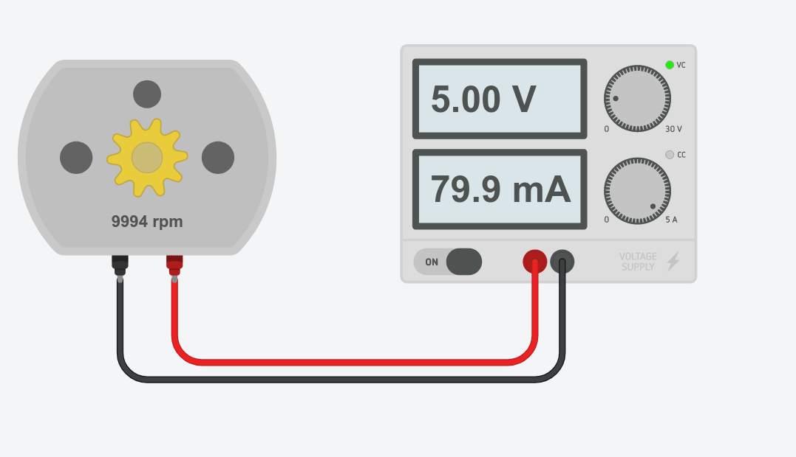
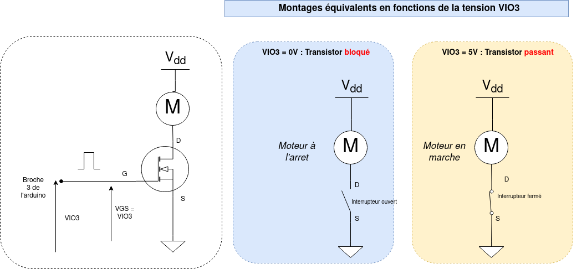
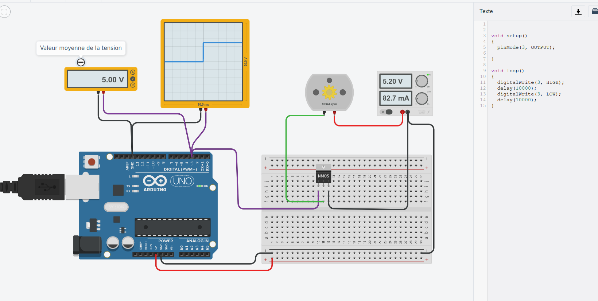
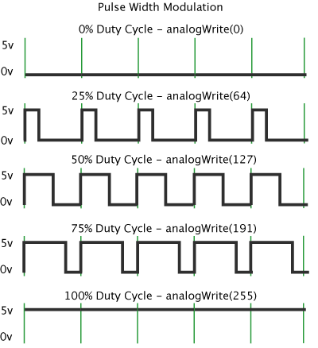
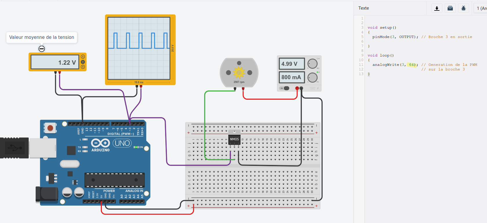

## Motoriser un axe : "système de manivelle cadre"

## Étude du moteur

On fait le choix du moteur à courant continu présent dans TinkerCAD :

!!! consigne
    Réaliser le schéma ci-dessus.

!!! consigne
    Pour différentes valeurs de la tension aux bornes du moteur, relever la vitesse en tour par minute (rpm en anglais) en remplissant le tableau suivant :

    | Tension (V) | 0 | 1 | 2 | 3,5 | 5 |
    |---|---|---|---|---|---|
    | Vitesse (tr/min) |   |   |   |   | 10000 |

!!! consigne
    Que constate-t-on ?

## Transistor MOSFET (acronyme anglais de Metal Oxide Semiconductor Field Effect Transistor)

Pour commander le moteur avec une carte Arduino il est indispensable d'insérer un transistor entre les deux. En effet un microcontrôleur peut fournir jusqu'à 20 mA par broche d'E/S, assez pour alimenter une LED mais insuffisant pour le moteur qui sans charge ici consomme déjà 80mA. On insère donc un transistor MOSFET.

Ce transistor possède 3 broches :

- G : La grille
- D : Le Drain
- S : La source

!!! consigne
    Visionner la video ci dessous "How Transistors works" :

    

Sans rentrer dans les détails, on considère ici le fonctionnement simplifié (idéalisé) : Interrupteur commandé par la tension VGS. Pour commander le moteur on le placera ainsi :

!!! consigne
    Sous tinkerCAD réaliser le montage et le programme suivant :

    

!!! consigne
    Que se passe -t-il ?

## Faire varier la vitesse d'un moteur avec du 0-5V ?

Nous avons vu que la valeur de la tension aux bornes du moteur agit sur sa vitesse. La carte arduino UNO comme beaucoup de carte microcontrôleur ne possède que des sorties numériques : soit 0 V ou 5V, pas de valeurs intermédiaires. La carte arduino est capable cependant de générer des signaux carrés dont la largeur d'impulsion est modulée (MLI ou PWM : Pulse Width Modulation).

!!! consigne
    Visionner la vidéo sur la PWM :

    [▶ Vidéo U=RI : Qu'est-ce que la PWM ? (YouTube)](https://www.youtube.com/results?search_query=U%3DRI+Qu%27est-ce+que+la+PWM)

la fonction AnalogWrite(pin, r) de Arduino permet de générer des signaux en PWM avec pin le N° de la broche et r doit être compris entre 0 (signal à 0V) et 255 (signal toujours à 5V) :

!!! consigne
    Modifier le code du projet afin de générer des signaux en PWM pour contrôler la vitesse du moteur :

    

!!! consigne
    Pour différentes valeurs de PWM compléter le tableau :

    | r | 0 | 32 | 64 | 128 | 255 |
    |---|---|---|---|---|---|
    | Tension moyenne (V) |   |   |   |   |   |
    | Vitesse du moteur |   |   |   |   |   |
