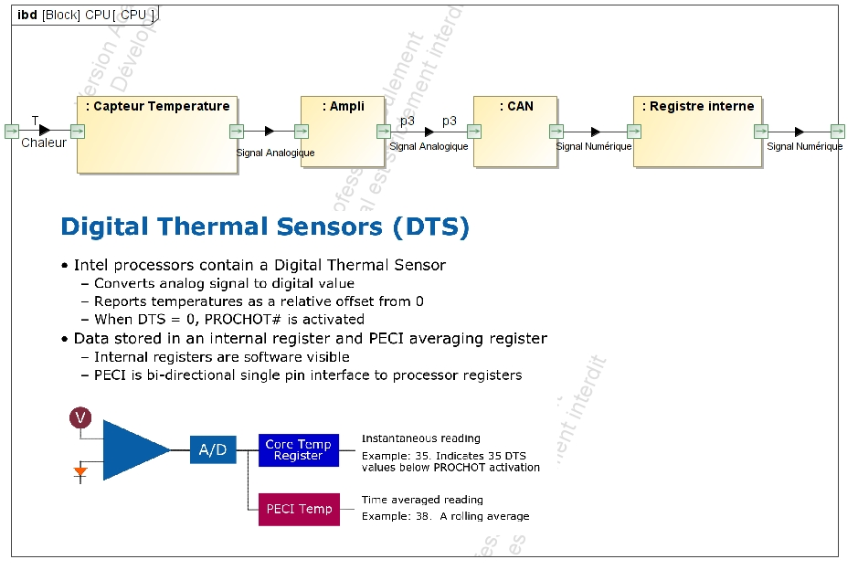
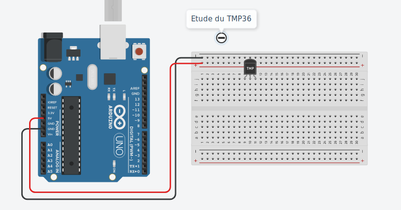

## Contexte

Dans un CPU de PC, la chaîne d'acquisition de la température est intégrée au composant. Dans ce TP on souhaite utiliser le TMP36 (capteur de température) pour simuler la mesure de la température d'un CPU et envoyé le résultat sur le terminal série à l'aide d'une carte Arduino UNO afin de bien comprendre les différents éléments de cette chaîne.

## Etude théorique du TMP36

!!! consigne
    Quelle est la plage de tension possible pour alimenter le TMP36 :

<!-- zone: 1 -->

!!! consigne
    Quelle est la plage d'utilisation normale du capteur ?

<!-- zone: 1 -->

!!! consigne
    Quelle est la précision du capteur ?

<!-- zone: 1 -->

!!! consigne
    A partir de la documentation technique du TMP36 reporter ci-dessous la caractéristique de la tension de sortie (OUTPUT VOLTAGE) en fonction de la température : **Vout=f(T°)** :

<!-- zone: 8 -->

!!! consigne
    Cette caractéristique est linéaire, il est donc possible de l'exprimer par la relation suivante :$Vout=a.T+V_0$ avec

    - $V_0$: Valeur de V pour $T = 0$.
    - $a$ : pente de la caractéristique.

    A partir de la caractéristique relevée précédemment, retrouver les valeurs des constantes suivantes :

    | $$ V_0 $$ | __________________________________________ |
    |---|---|
    | $$ a $$ | __________________________________________ |

## Simulation

Nous allons simuler le composant sous tinkerCAD et étudier son comportement avec une carte Arduino UNO.

!!! consigne
    Réaliser le montage suivant sous tinkerCAD (impEcran) :

On souhaite réaliser un programme qui affiche la valeur de la température mesurée par le capteur.

!!! consigne
    Sur quelles broches de la carte Arduino une acquisition analogique est possible ?

<!-- zone: 1 -->

!!! consigne
    Que réalise la fonction AnalogRead dans arduino (voir la doc officielle d'Arduino).

!!! consigne
    Réaliser un programme qui affiche sur le terminal série la valeur N résultante de la conversion Analogique Numérique

!!! consigne
    Tester le programme sous TinkerCAD pour différentes valeurs de température et réaliser sous calc le tableau suivant :

| T | N |
|---|---|
| ______________________________________ | ______________________________________ |
| ______________________________________ | ______________________________________ |
| ______________________________________ | ______________________________________ |
| ______________________________________ | ______________________________________ |
| ______________________________________ | ______________________________________ |

!!! consigne
    Tracer le diagramme correspondant (N en abscisse) et reporter là dans le compte-rendu (Ctrl-C, CtrlV)

!!! consigne
    On suppose une relation du type : $T = a* N + b$

    Calculer les paramètre, a et b, à l'aide de CALC.

!!! consigne
    A l'aide de l'expression ci-dessus, transformer votre programme pour qu'il affiche la température mesurée par le capteur.

## Réel

!!! consigne
    Réaliser le câblage en réel cette fois ci et comparer les résultats
