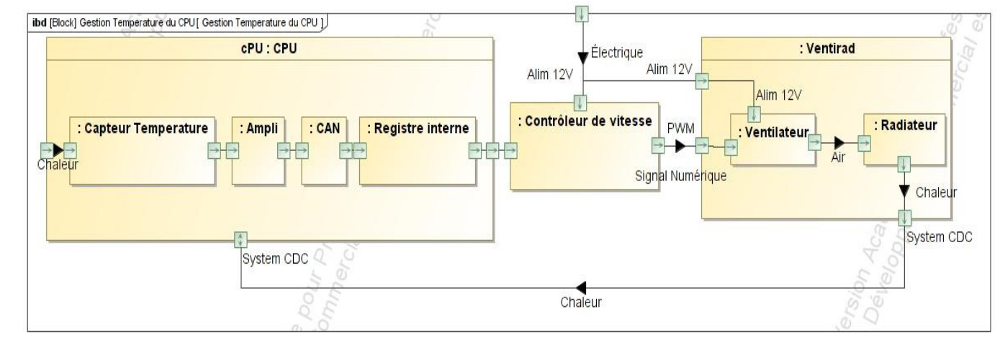
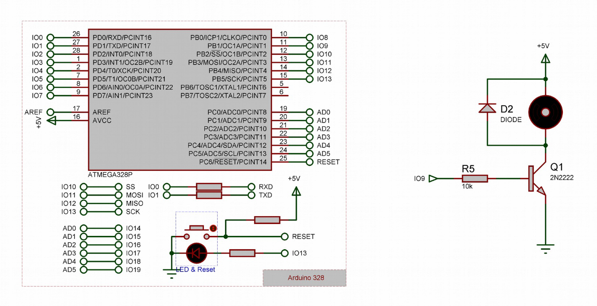
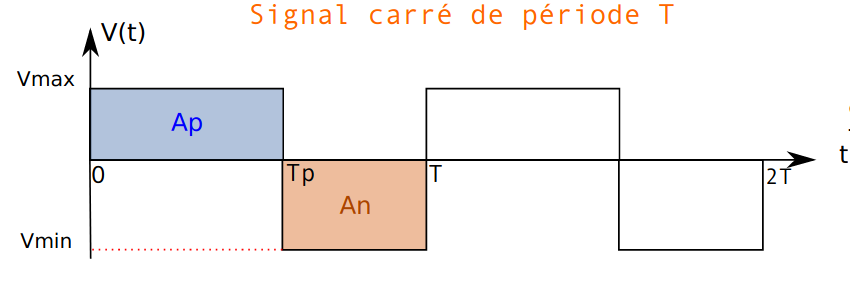
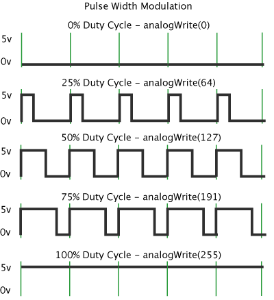
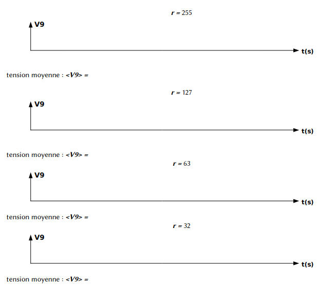

## Introduction

Pour piloter le moteur du ventilateur le CPU envoie une commande au contrôleur de vitesse qui assure l'alimentation électrique : 12 V continu et la variation de la vitesse en agissant sur le rapport cyclique d'un signal carré (PWM : Pulse Width Modulation).

!!! consigne
    Saisir le schéma suivant sous TinkerCAD :

Le moteur est un moteur à courant continu. Il est spécifié pour fonctionner en 5V.

!!! consigne
    Lire [https://si.blaisepascal.fr/1t-le-moteur-a-courant-continu/](https://si.blaisepascal.fr/1t-le-moteur-a-courant-continu/) sur les moteur à courant continu

!!! consigne
    Indiquer sur le schéma la base, l'émetteur et le collecteur du transistor

Le transistor fonctionne en mode « commutation ». Seulement 2 états possibles :

- T est **saturé** pour V_IO9 = 5V (tension de la broche IO9) :

Le transistor est assimilable à un circuit fermé entre le collecteur et l'émetteur Vce = 0,2 V

Vbe = 0,6 V

- T est **bloqué** pour V_IO9 = 0V (tension de la broche IO9) :

Le Le transistor est assimilable à un circuit ouvert entre le collecteur et l'émetteur

!!! consigne
    Tracer ci-dessous le schéma structurel équivalent dans les 2 cas suivants :

T est **saturé**

<!-- zone: 6 -->

T est **bloqué**

<!-- zone: 6 -->

!!! consigne
    Programmer le microcontrôleur pour les deux cas de figure IO9 est à l'état haut (V_IO9 = 5V) et IO9 à l'état bas (V_IO9 = 0V) et mesurer les tensions suivantes :

| IO9= HIGH | IO9 = LOW |
|---|---|
| Vce = | Vce = |
| Vbe = | Vbe = |
| V_IO9 = | V_IO9 = |
| Le transistor est _________________________ | Le transistor est_________________________ |

!!! consigne
    Quel est le rôle de la diode de roue libre D2 ?

<!-- zone: 11 -->

!!! extra "Valeur moyenne d'un signal carré"
    Pour calculer la valeur moyenne d'un signal carré, on doit calculer l'aire **Ap** du « rectangle » représentant la partie positive du signal et l'aire **An** représentant la partie négative du signal comme indiquer sur la figure ci-dessous :

    

    La valeur moyenne &lt;V> de la tension V vaut :

    $$
    <V> = (Ap +An) / T
    $$

    rapport cyclique (Duty cycle):

    On note le rapport cyclique α

    comme étant le rapport entre la période

    Tp et la période T :

    $$
    \alpha = \frac{T_p}{T}
    $$

    Dans le cas des signaux où Vmin vaux 0, la tension moyenne s'écrit :

    $$
    <V> = \alpha V_{max}
    $$

## Faire varier la vitesse d'un moteur avec du 0-5V ?

Nous avons vu que la valeur de la tension aux bornes du moteur agit sur sa vitesse. La carte arduino UNO comme beaucoup de carte microcontrôleur ne possède que des sorties numériques : soit 0 V ou 5V, pas de valeurs intermédiaires. La carte arduino est capable cependant de générer des signaux carrés dont la largeur d'impulsion est modulée (MLI ou PWM : Pulse Width Modulation).

!!! consigne
    Visionner la vidéo sur la PWM :

[▶ Vidéo U=RI : Qu'est-ce que la PWM ? (YouTube)](https://www.youtube.com/results?search_query=U%3DRI+Qu%27est-ce+que+la+PWM)

La fonction **AnalogWrite(pin, r)** de Arduino permet de générer des signaux en PWM avec pin le N° de la broche et r doit être compris entre 0 (signal à 0V) et 255 (signal toujours à 5V) :

!!! consigne
    Modifier le code du projet sous TinkerCAD afin de générer des signaux en PWM pour contrôler la vitesse du moteur.

!!! consigne
    Ajouter un oscilloscope pour observer le signal de la broche IO9.

<!-- zone: 2 -->

!!! consigne
    Pour différentes valeurs de PWM compléter le tableau :

!!! consigne
    Pour 4 valeurs de r reproduire ci-dessous le signal capté par l'oscilloscope et calculer sa valeur moyenne &lt;V9> :

| r | 0 | 32 | 64 | 128 | 255 |
|---|---|---|---|---|---|
| Tension moyenne (V) |   |   |   |   |   |
| Vitesse du moteur |   |   |   |   |   |

## Réel

!!! consigne
    A l'aide du matériel à disposition réaliser ce montage

!!! consigne
    Brancher un oscilloscope sur VIO9

!!! consigne
    Programmer la carte afin de générer des signaux en PWM pour les même valeur de rapport cyclique de la simulation et comparer avec la simulation.
