## Histoire de l’électronique

Le transistor est un élément actif en électronique, couramment employé comme amplificateur ou interrupteur électronique. Son invention remonte à décembre 1947, grâce aux efforts des chercheurs américains John Bardeen, William Shockley et Walter Brattain de la compagnie Bell Téléphone. Cette avancée majeure leur a valu le prix Nobel de physique en 1956. Grâce aux transistors, il est devenu possible de créer des portes logiques, comme les portes NAND ou NOR, et de concevoir des microprocesseurs. Leur miniaturisation a grandement élargi leur champ d'application.

`Exemple de miniaturisation` : nombre de transistors dans les microprocesseurs Intel :

- 1971 : 4004 : 2 300 transistors
- 1978 : 8086 : 29 000 transistors
- 1982 : 80286 275 000 transistors
- 1989 : 80486 : 1,16 million de transistors
- 1993 : Pentium : 3,1 millions de transistors
- 1995 : Pentium Pro : 5,5 millions de transistors
- 1997 : Pentium II : 27 millions de transistors
- 2001 : Pentium 4 : 42 millions de transistors
- 2004 : Pentium Extreme Edition : 169 millions de transistors
- 2006 : Core 2 Duo : 291 millions de transistors
- 2008 : Core 2 Quad : 410 millions de transistors
- 2010 : Intel Core i7, 1 170 000 000 transistors (1 milliard 170 millions)
- 2012 : Intel Core i3/i5/i7 (Ivy Bridge) 1 400 000 000 transistors
- 2015 : 15-core Xeon Ivy Bridge-EX 4 310 000 000 transistors (4 milliards 310 millions)

<!-- -->

- 2023 : Apple M2 Max : 67 milliards

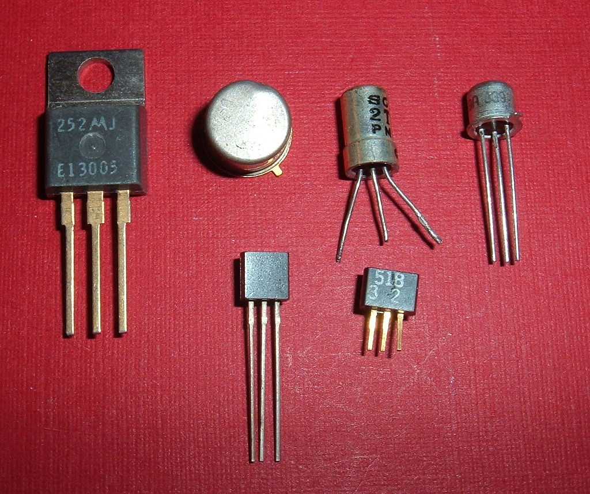

Le transistor remplaça alors le tube électronique (appelé aussi tube à lampe):

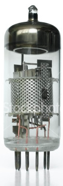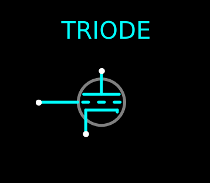 La triode inventée en 1907 par Lee De Forest permettra de poser les bases de l'électronique (Transmission radio, Calculateur, ... )

[▶ The Transistor, documentaire Bell Labs de 1953 (YouTube, chaîne AT&T)](https://www.youtube.com/watch?v=V9xUQWo4vN0)

## Symboles

Un transistor bipolaire est constitué de 2 jonctions PN (ou diodes) montées en sens inverse. Selon le sens de montage de ces diodes on obtient les 2 types de transistors bipolaires :

Sous l'effet de la polarisation en direct de la jonction B-E, avec un courant de base Ib on obtient un courant collecteur Ic dont la valeur sera notamment fonction des conditions de polarisation de la jonction B-E.

Ce courant Ic peut être nettement plus important que le courant de base Ib, c'est l'effet transistor.

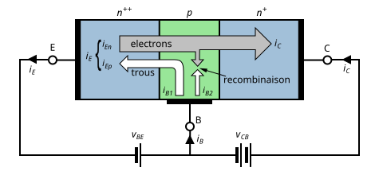

On ne peut considérer le transistor comme l'association de deux diodes mais la représentation suivante peut parfois aider :

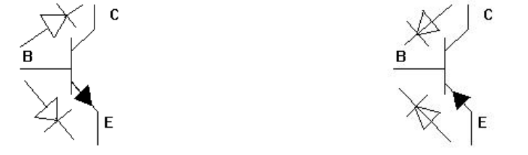

**Remarque 1** : la flèche indique toujours l'émetteur et le sens de circulation du courant.

**Remarque 2 :** c'est l'effet "transistor" qui permet au courant de traverser la diode en sens inverse.

## Analogie hydraulique

Transistor = robinet ;

| **Bloqué** | **Amplificateur** | **Saturé** |
|---|---|---|
| 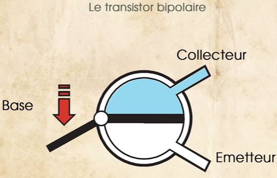 | 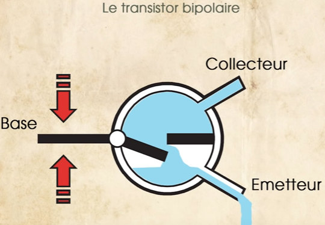 | 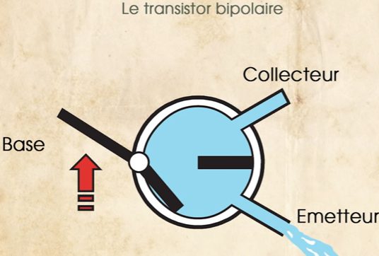 |

## Fonctionnement en amplification

Soit un transistor bipolaire npn :

Quand on fait circuler un petit courant dans la base (IB) du transistor, un courant plus important circule du collecteur vers l'émetteur (IC).

Le courant de base est multiplié par un coefficient β:

$$
IC = \beta × IB
$$

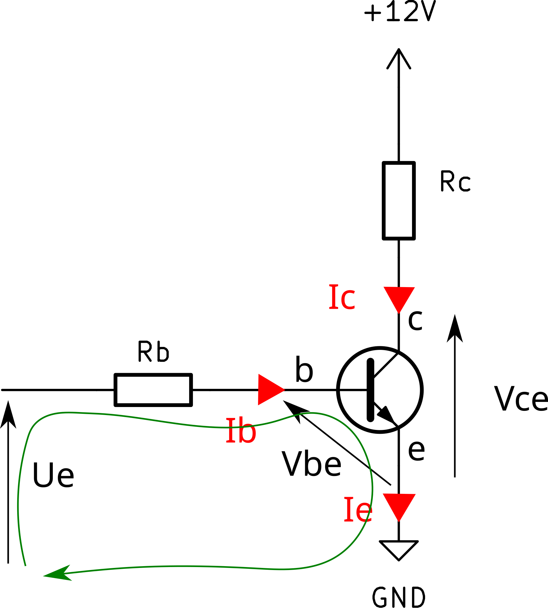

Quelques remarques :

- Ce coefficient β est appelé gain en courant du transistor
- Il est souvent noté Hfe dans les documentations techniques
- Il est parfois aussi appelé coefficient d'amplification statique en courant.
- En général β se situe entre 30 et 300.
- Si le courant IB est alternatif, le courant IC est alternatif (si IB est un signal sonore comme de la musique, IC est le même signal sonore mais plus fort)

## Calculs dans un montage amplificateur :

On fait la maille d'entrée : $VBE + (RB × IB) - UE = 0$

!!! warning
    **VBE** est la tension aux bornes de la diode présente entre la base et l'émetteur. Quand cette diode conduit, c'est à dire quant le transistor conduit, cette tension vaut à peu près 0,7V. La vraie valeur se trouve dans la documentation technique du transistor).

## Calcul de IB :

$$
IB = IC / \beta = 225.10^{-3}/100=2,25.10^{-3}=2,25mA
$$

Dans la maille d'entrée, la seule inconnue est RB donc :

$$
RB = (UE-VBE)/IB = (5-0,7)/2,25.10^{-3}=1911 \Omega
$$

**Remarque** : en amplification, **VCE** n'est pas une valeur constante et n'est pas facile à connaître.

## Fonctionnement en commutation

Le transistor en commutation est utilisé afin d'ouvrir ou de fermer un circuit (c'est une sorte d'interrupteur commandé). Ainsi il peut commander une LED, un relais, un moteur, etc... On considère généralement le circuit de sortie du transistor comme un interrupteur qui est commandé soit par une tension, soit par un courant suivant le type de transistor choisi.

Un transistor pourra avoir donc 2 états : soit il conduit soit il est bloqué.

**Exemple** : soit le montage ci-contre utilisé en commutation:

La tension UE pourra prendre 2 valeurs (0V ou 5V)

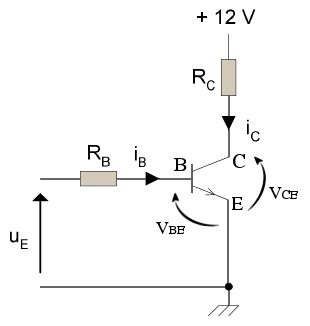

**1er cas : UE = 0V (0 logique)**

Le transistor ne peut conduire (IB=0 et VBE&lt;0,7V)

Alors on obtient :

- Ic = 0A
- VCE = 12V

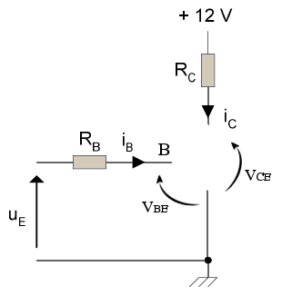

**2ème cas : UE = 5V (1 logique)**

Le transistor va conduire (**IB≠0** et **VBE=0,7V**)

En fait en commutation pour que l'on soit sûr que le transistor conduise on va le saturer. (par exemple, si dans notre calcul on trouve qu'il faut un courant **IB=2mA** pour que le transistor conduise (et fasse circuler le courant **IC** voulu) alors on choisira les éléments du montage pour avoir un courant de 4mA, on utilisera donc un coefficient de sursaturation de 2).

Quand un transistor est saturé, **VCE ≈ 0V** (en général &lt;0,5V. La vraie valeur se trouve dans la documentation technique du transistor).

## Exercice 1 : commande d'un relais

Dans un circuit électronique, la démarche initiale est toujours centrée sur la charge, car c'est elle qui impose une certaine tension et un courant spécifiques. Une fois les besoins en courant de la charge identifiés, on procède au calcul des composants du montage.

On donne $Ve$ peut être $0V$ ou $10V$.

Dans ce circuit, le relais agit comme la charge, avec $Irelais=55mA$ et $Vrelais =24Vcc$.

Les valeurs connues pour le transistor sont $VCEsat=0,4V$, $VBE=0,7V$, et $\beta=150$. Un facteur de sursaturation de $2$ est également pris en compte. De plus, $V+$ est de $24V$.

L'objectif est de déterminer certains composants du circuit, en particulier $Rb$.

!!! consigne
    1. Flécher les courants $Ib, Ic, Ie$sur le schéma. Pour $Ve = 0V$, calculer $Ib$, quel est l'état du transistor ?

!!! consigne
    \2. Lorsque Ve atteint $10V$, quel est l'état du transistor ? Calculer $Ib$

!!! consigne
    \3. Calculer la résistance $Rb$ que l'on doit mettre pour saturer le transistor avec un coefficient de sur-saturation de 2 ?

??? solution "Solution"
    1. Avec $Ve$ à $0V$, $Ib$ est nul, ce qui signifie que le transistor est en mode bloqué et que le relais (qui est une bobine) reste inactif.

    2. Lorsque Ve atteint $10V$, le transistor doit être en mode passant pour activer le relais.

    3. À partir de la sortie, nous déduisons que $Ic$ est égal à $Irelais$, soit $55mA$.

       Pour trouver $Ib$, on utilise la relation $Ic = \beta × Ib$, d'où $Ib = Ic / \beta = 55.10^{-3} / 150 = 3,67.10^{-4}A$.

       En prenant en compte le facteur de sursaturation, $IBsat$ devient $2 × 3,67.10^{-4} = 7,33.10^{-4}$A.

       En se basant sur la boucle d'entrée, l'équation est : $VBE + VRb - Ve = 0$, soit $VBE + (Rb × IBsat) - Ve = 0$.

       Ainsi, $Rb$ peut être calculé comme $(Ve-VBE) / IBsat = (10 - 0,7) / 7,33.10^{-4}$, ce qui donne $12,69kΩ$.

!!! example "Commande d'une LED"
    Soit le montage suivant :

    Données : V+=12V, VDEL=1,6V, IDELmax=30mA, β=250, VBE=0,7V, VCEsat=0,3V, Ve=0 ou 5V

    Le transistor sera utilisé en commutation (coefficient de sursaturation=2)

    !!! consigne
        1°) lorsque Ve=0V, donner l'état du transistor (bloqué ou conducteur). En déduire l'état de la diode électroluminescente. Représenter le schéma équivalent du transistor et de la LED.

    <!-- zone: 6 -->

    !!! consigne
        2°) lorsque Ve=5V, donner l'état du transistor (bloqué ou conducteur). En déduire l'état de la diode électroluminescente. Représenter le schéma équivalent du transistor et de la LED.

    <!-- zone: 6 -->

    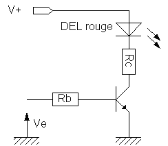
