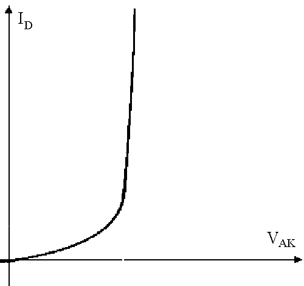
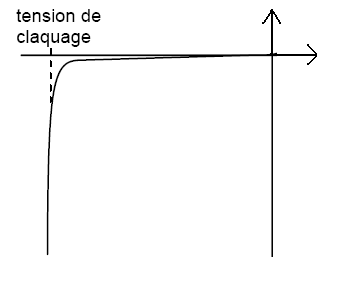
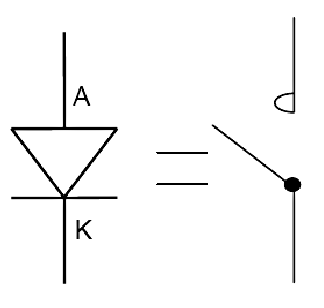
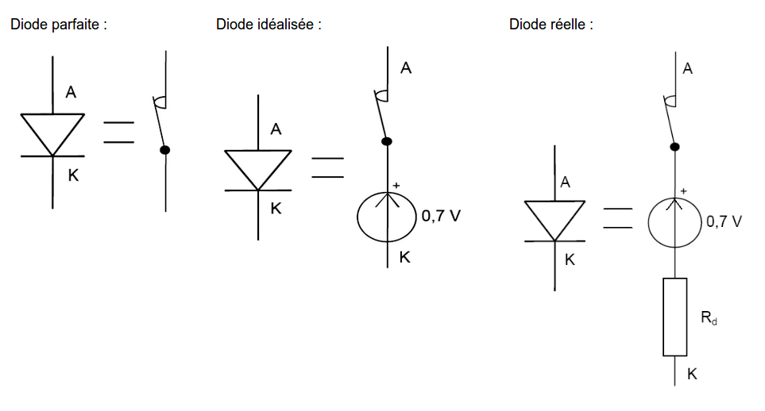
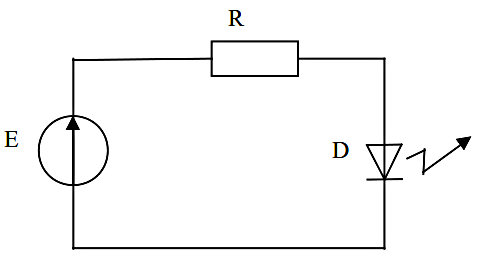
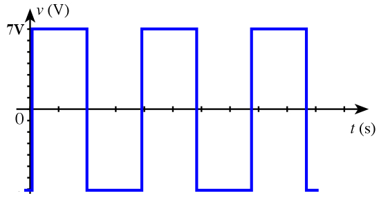
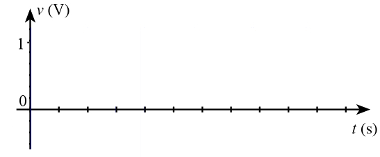
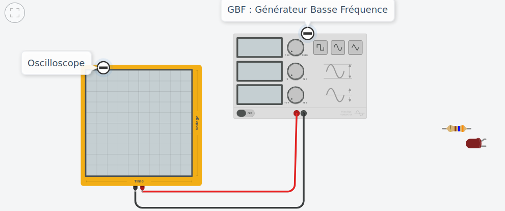
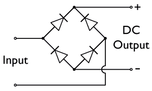

!!! info
    **Généralités :**

    La diode est un composant électronique qui permet le passage **unidirectionnel** du courant, de l'anode et la cathode.

    Analogie hydraulique : C'est un peu un "**clapet** pour les électrons".

    

    

    Il existe deux caractéristiques différentes, en direct et en inverse.

    **En direct :**

!!! info
    Caractéristique réelle $ID =f(V_{AK})$ ou $IF=f(V_F)$ :

    

    

    Dans la première partie de la courbe ($V_{AK}<V_D$) le courant ne passe pas, la diode est bloquée.

    Ensuite, quand $V_{AK} > V_D$, le courant passe, la diode conduit.

    $V_D$ (ou $Vs$) est appelée tension de seuil de la diode. (VD≈0,6V à 0,7V pour une diode classique)

    **En inverse :**

    Schéma du montage d'essai :

    

    Attention cet essai peut détruire la diode !

    

    **Modèle équivalent simplifié :**

    `Diode en inverse : (bloquée)`

    

    `Diode en directe (passante):`

    

## Exercice 1

Soit le montage suivant:

Données:

R = 360Ω.

Diode D: LED: Rd=0.15Ω,

VS=1,65V (tension de seuil de la diode)

IFmax (courant max dans la diode max) : 20mA

!!! consigne
    Justifier l'état de la diode (bloquée ou passante) pour E=9V (pile).

<!-- zone: 4 -->

!!! consigne
    Justifier l'état de la diode (bloquée ou passante) pour E=1,5V (pile AAA).

<!-- zone: 4 -->

On remplace maintenant E par un signal de la forme :

!!! consigne
    Expliquer ce qui va se passer

<!-- zone: 4 -->

!!! consigne
    Tracer la courbe de l'état de la Led en fonction du temps : led=f(t) avec led éteinte=0 et led allumée = 1 :

!!! consigne
    Sous Tinkercad réaliser un circuit à partir des éléments ci-dessous et vérifier votre résultat :

## Exercice 2 : Redressement simple alternance

On considère la diode comme un circuit fermé lorsqu'elle est en conduction et comme un circuit ouvert lorsqu'elle est bloquée.

L'expression de la tension $V_1$, est sinusoïdale avec une fréquence de $50 \text{Hz}$ et une valeur efficace de $24 \text{V}$, est :

$$
V_1(t) = 24 \sqrt{2} \sin(2\pi \times 50 t)
$$

Où :

- $24\sqrt{2}$est la valeur maximale de la tension (amplitude) car la valeur efficace d'une sinusoïde est $V_{\text{max}}/\sqrt{2}$.
- $2\pi \times 50 t$ donne l'angle de phase en radian pour une fréquence de $50 \text{Hz}$ .

La valeur de $24 \sqrt{2}$ s'obtient en multipliant la valeur efficace ($24V$) par $\sqrt{2}$ pour obtenir la valeur de crête de la sinusoïde.

!!! consigne
    Représenter ci-dessous le schéma équivalent du montage lorsque la diode est passante et exprimer $V_2$.

<!-- zone: 5 -->

!!! consigne
    Représenter ci-dessous le schéma équivalent du montage lorsque la diode est bloquée et exprimer $V_2$.

<!-- zone: 5 -->

!!! consigne
    Tracer $V_1$ sur 2 période$T = 1/F$. Ajouter en rouge les périodes où D conduit et en vert celle ou D est bloquée.

!!! consigne
    Tracer $V_2$ en correspondance.

<!-- zone: 4 -->

!!! consigne
    Réaliser la simulation sous tinkerCAD

!!! consigne
    Câbler le GBF, l'oscilloscope et les différents composant et observer à l'oscilloscope les tensions $V_1$ et $V_2$ et comparer les résultats avec la partie théorique.

## Exercice 3 : Redressement double alternance

!!! consigne
    Se documenter pour comprendre le fonctionnement sur le pont de diode ou [https://fr.wikipedia.org/wiki/Pont_de_diodes](https://fr.wikipedia.org/wiki/Pont_de_diodes)

!!! consigne
    Simuler sous TinkerCAD [https://www.falstad.com/circuit/circuitjs.html?ctz=CQAgjCAMB0l3BWcMBMcUHYMGZIA4UA2ATmIxAWwosgoFMBaMMAKADdxDbsEVPbCAFijgQg2klpToCFgHd+IISFzDlkeSshrhq8CjxQWAEy3CwBlYUNhifPsboAzAIYBXADYAXE2ZAoEQisbO38QR1dPH1MUcXBQvQtDB2d3b19Y2ls+PQCglMj0hVzAvx4+DWLtFV5FcqMFTPj7OINDSuDmsTAg7Ib-VrxDQR7-IaMAJ27e0JH88ay4FgAPMUIqWMMEVoQIYTQQDwB7F2MWI5F1MUhSahhISTDuc-0lYVpxW8lYJAg+CxULCAA](https://www.falstad.com/circuit/circuitjs.html?ctz=CQAgjCAMB0l3BWcMBMcUHYMGZIA4UA2ATmIxAWwosgoFMBaMMAKADdxDbsEVPbCAFijgQg2klpToCFgHd+IISFzDlkeSshrhq8CjxQWAEy3CwBlYUNhifPsboAzAIYBXADYAXE2ZAoEQisbO38QR1dPH1MUcXBQvQtDB2d3b19Y2ls+PQCglMj0hVzAvx4+DWLtFV5FcqMFTPj7OINDSuDmsTAg7Ib-VrxDQR7-IaMAJ27e0JH88ay4FgAPMUIqWMMEVoQIYTQQDwB7F2MWI5F1MUhSahhISTDuc-0lYVpxW8lYJAg+CxULCAA)

!!! consigne
    Câbler le GBF, l'oscilloscope et les différents composant et observer à l'oscilloscope les tensions d'entrée et de sortie et comparer les résultats avec la partie théorique.

