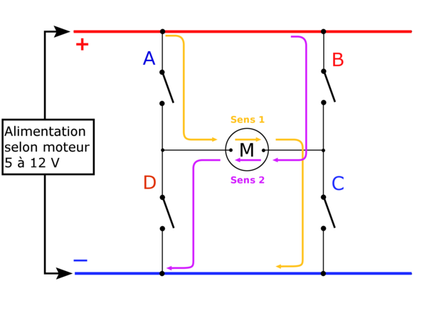
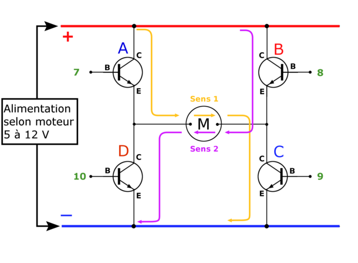
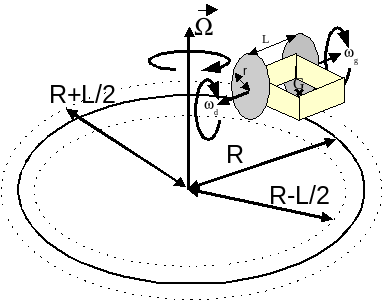

## Commande du sens de rotation avec un pont en H :

Le pont en H va nous permettre de commander le sens de rotation du moteur. Les figures ci-dessous expliquent le principe grâce à un montage constitué de quatre interrupteurs et du moteur **M** à commander.

- État initial : Tous les interrupteurs sont ouverts donc le courant de l'alimentation ne peut pas parvenir au moteur. Le moteur est à l'arrêt.

<!-- -->

- Lorsque l'on ferme les interrupteurs A et C, B et D restant ouverts, le courant électrique parvient au moteur en suivant le cheminement en jaune : le moteur tourne dans un sens.

<!-- -->

- En ouvrant A et C : le moteur s'arrête (état initial). Si les interrupteurs B et D se ferment, A et C restant ouverts. Le courant électrique parvient au moteur en suivant le cheminement figuré en violet : le moteur tourne dans l'autre sens.



[Animation](animation.gif)

!!! warning
    Il ne faut surtout pas fermer en même temps les interrupteurs A et D, ou bien B et C, car on créerait un court-circuit avec l'alimentation.

!!! info
    <!-- zone: 7 -->

## Montage avec des transistors

En remplaçant les interrupteurs par des interrupteurs électroniques, commandés par des courants ou des tensions, comme des transistors bipolaires par exemple on obtient le schéma ci-contre. L'avantage ici est que l'on peut commander ces transistors en tension.



## Circuit JS

!!! consigne
    Simuler ce [https://www.falstad.com/s.py?s=YYiMk5](https://www.falstad.com/s.py?s=YYiMk5) du pont en H pour permettre la rotation du moteur dans les deux sens.

## Schéma structurel ponts en H

A partir du [schéma structurel](2wd_miniQ.pdf)  :

!!! consigne
    - Entourer la partie concernant le pilotage des deux moteurs.
    - Identifier les portes ET
    - Identifier le pont en H

Les signaux DIR1, PWM1 et DIR2, PWM2 permettent de contrôler les moteurs 1 et 2. Nous allons tenter de comprendre comment en analysant le schéma structurel.

!!! consigne
    Sur le schéma structurel identifier les fils DIR1, DIR2, PWM1, PWM2 et compléter le tableau suivant.

| BROHES | Rôle |
|---|---|
| DIR1,DIR2 | _________________________________________________________________________<br>_________________________________________________________________________<br>_________________________________________________________________________ |
| PWM1, PWM2 | _________________________________________________________________________<br>_________________________________________________________________________ |

## Code pour utiliser les moteurs

Il est possible de trouver des exemples de programmation du robot dans [http://www.dfrobot.com/index.php?route=product/product&product_id=555#.Uy3mkPi4AW0](http://www.dfrobot.com/index.php?route=product/product&product_id=555#.Uy3mkPi4AW0) par exemple. À partir de ces exemples un code source légèrement modifié pour être conforme au schéma de principe est présenté :

```cpp
// Broches de control du moteur 1
const int PWM1 = 6; // PWM moteur 1
const int DIR1 = 7; // Broche control de la direction
// Broches de control du moteur 2
const int PWM2 = 5;  // PWM moteur 2
const int DIR2 = 12; // Broche control de la direction
// Constante pour le pilotage 
const int AVANCER = 0; //go forward
const int RECULER = 1; //go back
/* Fonction pilotage des moteurs :
Moteur 1 droite (vue du dessus)
M1_DIR : AVANCER/RECULER
M1_PWM  : 1-255 (PWM) 0 -> STOP
Moteur 2 gauche (vue du dessus)
M2_DIR : AVANCER/RECULER
M2_PWM  : 1-255 (PWM) 0 -> STOP
*/
void Motor_Control(int M1_DIR,int M1_PWM,int M2_DIR,int M2_PWM)//control motor
{
  //////////M1////////////////////////
  if(M1_DIR==AVANCER)
    digitalWrite(DIR1,AVANCER);
  else
    digitalWrite(DIR1,RECULER);
  if(M1_PWM==0)
    analogWrite(PWM1,LOW);//stop
  else
    analogWrite(PWM1,M1_PWM); //Vitesse

  ///////////M2//////////////////////
  if(M2_DIR==AVANCER)
    digitalWrite(DIR2,AVANCER);
  else
    digitalWrite(DIR2,RECULER);
  if(M2_PWM==0)
    analogWrite(PWM2,LOW);
  else
    analogWrite(PWM2,M2_PWM);
}
void setup()
{
  pinMode(DIR1,OUTPUT); // Broches moteurs en sortie
  pinMode(PWM1,OUTPUT);
  pinMode(DIR2,OUTPUT);
  pinMode(PWM2,OUTPUT);

  Serial.begin(9600);

}
void loop()
{
  Motor_Control(AVANCER,60,AVANCER,60);//run motor
  delay(5000);
  Motor_Control(RECULER,60,RECULER,60);//run motor
  delay(5000);
}
```

Objectif général  :Vous devrez réaliser une commande du robot pour qu'il réalise un huit (deux cercles connectés par un point). Vous choisirez le rayon de vos cercles en jouant sur les rapports cycliques. Puis vous jouerez sur les temporisations pour gérer tout cela. Bien entendu, le fait qu'il n'y ait pas d'information de retour sur l'endroit où vous êtes complique un peu la mise au point.



## Exercice 1

!!! consigne
    Modifier le programme ci-dessus pour réaliser un simple cercle. Seule la partie loop() est à modifier !

!!! warning "Vos essais seront faits sur la table de travail."
    - Il y a des risques de chutes ! Soyez donc prudents !
    - Ne mettez pas de vitesses excessives !
    - N'oubliez pas que votre câble USB n'est pas infini !

## Exercice 2

!!! consigne
    Réaliser maintenant votre huit (deux cercles se touchant par un point). On pourra réaliser tout cela dans le noir avec une prise de trajectoire par appareil photo à pose longue.

## Exercice 3

Etude du rayon du cercle. Sanchant que la trajectoire :Essayez d'étudier si le rayon peut s'écrire $R=K \frac{\alpha _g+\alpha _d}{\alpha _g-\alpha _d}$où α $\alpha _{g}$ et $\alpha _{d}$ désignent le rapport cyclique des moteurs gauche et droit (qui varient entre 0 et 255) et K est une constante à déterminer.
