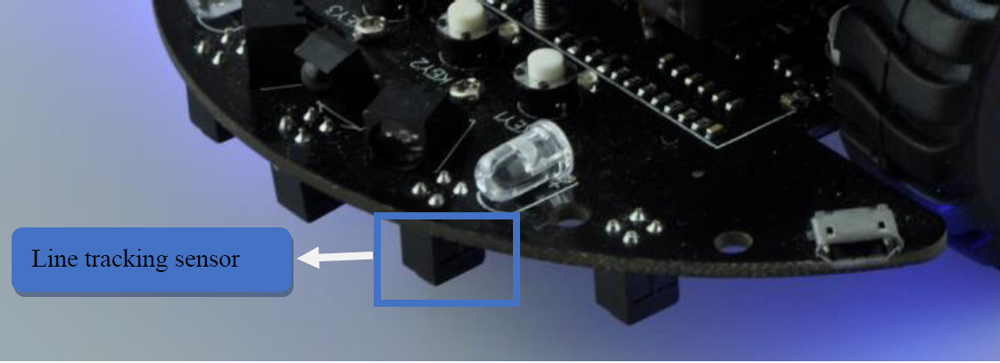
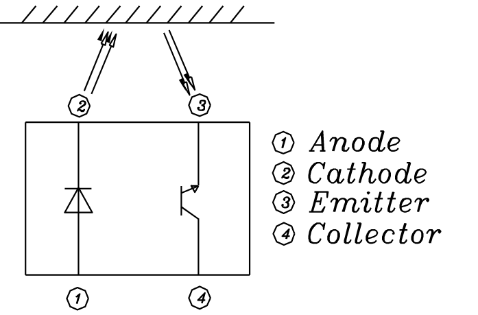
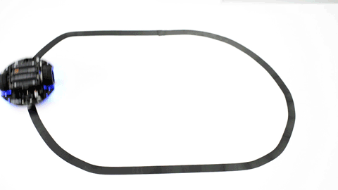

## Analyse du détecteur

Le robot mini-Q est équipé de cinq couples leds/photo-transistors (infra-rouge) dirigés vers le bas. Ils sont destinés à mesurer la réflexion du support sur lequel roule le robot.



!!! consigne
    Sur le schéma structurel de la carte entourer la partie concernant les 5 détecteurs infrarouges.

!!! consigne
    Quel est la référence de ces détecteur ?

D'après la[https://cdn-shop.adafruit.com/product-files/3930/ITR20001-T.pdf](https://cdn-shop.adafruit.com/product-files/3930/ITR20001-T.pdf) la structure interne du capteur est la suivante :



!!! consigne
    Reproduire ci-dessous le schéma d'une cellule :

<!-- zone: 4 -->

!!! consigne
    Quel est l'état du photo-transistor lorsqu'il ne reçoit pas de lumière (Noir) ?

<!-- zone: 3 -->

!!! consigne
    Même question lorsque la lumière infra-rouge est réfléchie (Blanc) ?

<!-- zone: 3 -->

!!! consigne
    Rechercher dans la [https://cdn-shop.adafruit.com/product-files/3930/ITR20001-T.pdf](https://cdn-shop.adafruit.com/product-files/3930/ITR20001-T.pdf)[[https://cdn-shop.adafruit.com/product-files/3930/ITR20001-T.pdf](https://cdn-shop.adafruit.com/product-files/3930/ITR20001-T.pdf)](https://cdn-shop.adafruit.com/product-files/3930/ITR20001-T.pdf) son temps de monté et son temps de descente :

<!-- zone: 3 -->

Si vous prenez un support blanc et que vous fixez un scotch noir vous arriverez à détecter le support noir qui n'a pas la même réflectance infra-rouge que le support blanc.

Les sensibilités des capteurs ne sont pas identiques, un calibrage de chacun des capteurs peut se faire par le programme simple :

```cpp
int data[5]={0};// Valeur des 5 capeurs
void setup(){
    Serial.begin(9600);
}
void Read_IRLine(void){ // Lecture des capteurs de ligne

    data[0]=analogRead(A0); // gauche
    data[1]=analogRead(A1);
    data[2]=analogRead(A2); // milieu
    data[3]=analogRead(A3);
    data[4]=analogRead(A4); // droite
}

void loop(){
    Read_IRLine();
    for (char i=0;i<5;i++){
        Serial.print(data[i]);
        Serial.print(" ");
    }
    Serial.println(" ");
    delay(1000);
}
```

!!! consigne
    Remplir le tableau suivant :

|   | Noir | Blanc | Seuil de détection |
|---|---|---|---|
| data\[0\] |   |   |   |
| data\[1\] |   |   |   |
| data\[2\] |   |   |   |
| data\[3\] |   |   |   |
| data\[4\] |   |   |   |

## Suiveur de ligne.



Dans cette partie vous devez utiliser la fonction Motor_Control de l'activité précédente et la fonction Read_IRLine() ci dessous pour réaliser un programme permettant au robot de suivre une ligne :


Une première étape ci-dessous sans la partie commande moteur à tester :

```cpp
/* Suiveur de ligne sans Commande moteur : 

La commande des moteurs est simulee par une sortie au terminal serie.

*/ 
int data[5]={0};// Valeur des 5 capeurs

/* Les seuils calculés avec les valeurs de calibration prises sur la
   piste.

 */
const int SEUIL0 = (290 + 986)/2;
const int SEUIL1 = (270 + 988)/2;
const int SEUIL2 = (384 + 988)/2;
const int SEUIL3 = (448 + 990)/2;
const int SEUIL4 = (388 + 990)/2;


void setup(){
    Serial.begin(9600);
}

void Read_IRLine(void){ // Lecture des capteurs de ligne

    data[0]=analogRead(A0); // gauche
    data[1]=analogRead(A1);
    data[2]=analogRead(A2); // milieu
    data[3]=analogRead(A3);
    data[4]=analogRead(A4); // droite
}

void loop(){
    Read_IRLine();
    for (char i=0;i<5;i++){
        Serial.print(data[i]);
        Serial.print(" ");
    }
    Serial.println(" ");
    if(data[1]< SEUIL1 && data[3] > SEUIL3)// SI ligne noir a gauche 
    {
      Serial.println("Tourner a gauche");
    }
    else if(data[1] > SEUIL1 && data[3] < SEUIL3) // SI ligne noir a droite
    {
      Serial.println("Tourner a droite");
    }
    else if (data[1] > SEUIL1 && data[2] < SEUIL2 && data[3] > SEUIL3)
    {
      Serial.println("Avancer ");
    }
    else 
    {
      Serial.println("Doucement ..");
    }
    delay(1000);
}
```

!!! consigne
    Réaliser la fusion entre la partie commande moteur et le programme ci-dessus afin de répondre à l'algorithme de suivi de ligne.
