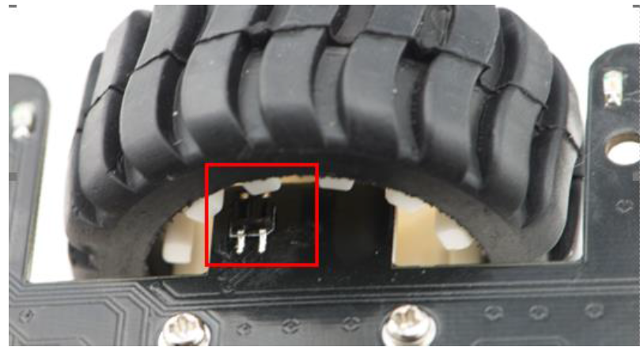

## Comment réguler la vitesse du robot ?

Deux paramètres de la fonction Motor_Control permettent de faire varier la vitesse des roues. On a vu qu'il était assez difficile d'obtenir une vitesse identique pour les deux moteurs avec une même valeur de paramètre. L'objectif ici va être  à partir d'une consigne de vitesse Vc :

1. De mesurer la vitesse des 2 moteurs
2. D'ajuster la commande en fonction de la différence entre la consigne et les mesures

On parle de **régulation de vitesse**. Le robot possède un encodeur par roue :



C'est la même technologie que pour le suiveur de ligne : une diode IR et un photo-transistor intégré dans le même boîtier.

!!! consigne
    Repérer sur le [schéma](../ROB0081_V2_Schematic.pdf) ces deux détecteurs infrarouge.

!!! consigne
    Sur quel broche du micro-contrôleur sont relié les deux signaux ?

<!-- zone: 1 -->

!!! consigne
    Représenter le schéma d'une cellule lorsqu'il n'y a pas d'IR recu :

<!-- zone: 4 -->

!!! consigne
    Représenter le schéma d'une cellule lorsqu'il y a de l'IR reçu :

<!-- zone: 4 -->

!!! consigne
    Si la roue tourne à une vitesse de 100 tr/min, représenter ci-dessous la tension V0(t).

<!-- zone: 4 -->

!!! consigne
    Exprimer la relation entre T(en s) la période du signal et N( en tr/s) la vitesse de la roue sachant que lorsque la roue fait un tour le signal décrit 12 périodes.

<!-- zone: 4 -->

!!! consigne
    Réaliser un programme qui affiche l'état des signaux reçu au terminal série.

!!! consigne
    Que constate-t-on lorsque l'on fait tourner les roues (attention à ne pas trop forcer) ?

<!-- zone: 4 -->

## Interruptions

Ainsi en mesurant la période du signal on pourra déterminer la vitesse de la roue. Pour cela on utilisera une interruption.

!!! consigne
    A l'aide d'une carte Arduino et du module groove suivre [cette activité](35_10.atelier_arduino_interruptions.pdf) tirée du site de mon club elec.

## Etude du moteur droit

Le programme suivant permet la mesure de la vitesse du moteur droit :

```cpp
// Broches de control du moteur 1
const int EN1 = 6; // Broche Marche/Arret Moteur
const int PWM1 = 7; // Broche control de la direction

// Broches de control du moteur 2
const int EN2 = 5;  // Broche Marche/Arret Moteur 
const int PWM2 = 12; // Broche control de la direction
// Constante pour le pilotage 
const int AVANCER = 0; //go forward
const int RECULER = 1; //go back
// Broches encodeurs droit et gauche:
const int ENCD = 0;
const int ENCG = 1;

volatile int count = 0;
long t0;
const int T = 500;
/* Fonction pilotage des moteurs :
Moteur 1 : Droite 
M1_DIR : AVANCER/RECULER
M1_EN  : 1-255 (PWM) 0 -> STOP
Moteur 2 : Gauche
M2_DIR : AVANCER/RECULER
M2_EN  : 1-255 (PWM) 0 -> STOP
*/
void Motor_Control(int M1_DIR,int M1_EN,int M2_DIR,int M2_EN)//control motor
{
  //////////M1////////////////////////
  if(M1_DIR==AVANCER)
    digitalWrite(PWM1,AVANCER);
  else
    digitalWrite(PWM1,RECULER);
  if(M1_EN==0)
    analogWrite(EN1,LOW);//stop
  else
    analogWrite(EN1,M1_EN); //Vitesse

  ///////////M2//////////////////////
  if(M2_DIR==AVANCER)
    digitalWrite(PWM2,AVANCER);
  else
    digitalWrite(PWM2,RECULER);
  if(M2_EN==0)
    analogWrite(EN2,LOW);
  else
    analogWrite(EN2,M2_EN);
}

void setup()
{
  pinMode(ENCD,INPUT);// Encoder droit
  attachInterrupt(digitalPinToInterrupt(ENCD), incrementer_compteur, CHANGE);

  Serial.begin(9600);
  pinMode(EN1  ,OUTPUT); // Broches moteurs en sortie
  pinMode(PWM1 ,OUTPUT);
  pinMode(EN2  ,OUTPUT);
  pinMode(PWM2 ,OUTPUT);
  Motor_Control(AVANCER,80,AVANCER,0); // Moteur droit
  t0 = millis();
  }
void loop()
{
    if(millis() - t0 > T)
    {
      Serial.print("count : ");
      Serial.println(count);
      Serial.print("vitesse :");
      float vitesse = (60.0*1000.0*(float)count)/( 24.0 *(float)T);
      Serial.print(vitesse);
      Serial.println(" tr/min");
      count = 0;
      t0 = millis();
    }
 
}

void incrementer_compteur() {
  count ++;
}
```

!!! consigne
    Tester le programme ci-dessus pour différentes valeurs de vitesse (20 à 255)

    | Commande | 30 | 50 | 100 | 255 |
    |---|---|---|---|---|
    | Vitesse |   |   |   |   |

On souhaite agir sur la commande pour réguler la vitesse de rotation du moteur droit selon une consigne \$Vc\$ donnée en tr/min.

!!! consigne
    Réaliser un algorigramme du programme de la régulation de vitesse du moteur droit à l'aide de [https://www.draw.io/](https://www.draw.io/)

!!! consigne
    Implémenter la solution.

## Régulation 1 roue

```cpp
// Broches de control du moteur 1
const int EN1 = 6; // Broche Marche/Arret Moteur
const int PWM1 = 7; // Broche control de la direction

// Broches de control du moteur 2
const int EN2 = 5;  // Broche Marche/Arret Moteur 
const int PWM2 = 12; // Broche control de la direction
// Constante pour le pilotage 
const int AVANCER = 0; //go forward
const int RECULER = 1; //go back
// Broches encodeurs droit et gauche:
const int ENCD = 0;
const int ENCG = 1;
// Variables pour le calcul de la vitesse
volatile int count = 0; // Nb impulsion
long t0; 
const int T = 100; // Periode d'echantillonnage en ms
// Consigne vitesse :

float Vc = 100.0; // Consigne de vitesse 
float E  = 0.0;   // Erreur
float K  = 0.1; // Correcteur proportionnel
int   C  = 127;   // Commande vitesse
/* Fonction pilotage des moteurs :
Moteur 1 : Droite 
M1_DIR : AVANCER/RECULER
M1_EN  : 1-255 (PWM) 0 -> STOP
Moteur 2 : Gauche
M2_DIR : AVANCER/RECULER
M2_EN  : 1-255 (PWM) 0 -> STOP
*/
void Motor_Control(int M1_DIR,int M1_EN,int M2_DIR,int M2_EN)//control motor
{
  //////////M1////////////////////////
  if(M1_DIR==AVANCER)
    digitalWrite(PWM1,AVANCER);
  else
    digitalWrite(PWM1,RECULER);
  if(M1_EN==0)
    analogWrite(EN1,LOW);//stop
  else
    analogWrite(EN1,M1_EN); //Vitesse

  ///////////M2//////////////////////
  if(M2_DIR==AVANCER)
    digitalWrite(PWM2,AVANCER);
  else
    digitalWrite(PWM2,RECULER);
  if(M2_EN==0)
    analogWrite(EN2,LOW);
  else
    analogWrite(EN2,M2_EN);
}

void setup()
{
  pinMode(ENCD,INPUT);// Encoder droit
  attachInterrupt(digitalPinToInterrupt(ENCD), incrementer_compteur, CHANGE);

  Serial.begin(9600);
  pinMode(EN1  ,OUTPUT); // Broches moteurs en sortie
  pinMode(PWM1 ,OUTPUT);
  pinMode(EN2  ,OUTPUT);
  pinMode(PWM2 ,OUTPUT);
  Motor_Control(AVANCER,0,AVANCER,0); // Moteur droit
  t0 = millis();
  }
void loop()
{
    if(millis() - t0 > T)
    {
      float V = (60.0*1000.0*(float)count)/( 24.0 *(float)T); // Vitesse mesuree
      E = (Vc - V); // Erreur
      C = C + int(K * E);

      if(C<0)   
        C = 0;
      if(C > 255)  
        C = 255;
      Motor_Control(AVANCER,C,AVANCER,0); // Moteur droit
//      Serial.print("C : ");
//      Serial.println(C);
//      Serial.print("V  :");
//      Serial.println(V);
//      Serial.print("Vc  :");
//      Serial.println(Vc);
      Serial.println(V);
//      Serial.println(" tr/min");
      count = 0;
      t0 = millis();
      
    }

}

void incrementer_compteur() {
  count ++;
}
```

## Régulation 2 roues

```cpp
// Broches de control du moteur 1
const int EN1 = 6; // Broche Marche/Arret Moteur
const int PWM1 = 7; // Broche control de la direction

// Broches de control du moteur 2
const int EN2 = 5;  // Broche Marche/Arret Moteur 
const int PWM2 = 12; // Broche control de la direction
// Constante pour le pilotage 
const int AVANCER = 0; //go forward
const int RECULER = 1; //go back
// Broches encodeurs droit et gauche:
const int ENCD = 0;
const int ENCG = 1;

// Variables pour le calcul de la vitesse
volatile int countD = 0; // Nb impulsion
volatile int countG = 0; // Nb impulsion
long t0; 
const int T = 100; // Periode d'echantillonnage en ms
// Consigne vitesse :

float VDc = 150.0; // Consigne de vitesse 
float ED  = 0.0;   // Erreur
int   CD  = 50;   // Commande vitesse

float VGc = 150.0; // Consigne de vitesse 
float EG  = 0.0;   // Erreur
int   CG  = 50;   // Commande vitesse

float K  = 0.1; // Correcteur proportionnel
/* Fonction pilotage des moteurs :
Moteur 1 : Droite 
M1_DIR : AVANCER/RECULER
M1_EN  : 1-255 (PWM) 0 -> STOP
Moteur 2 : Gauche
M2_DIR : AVANCER/RECULER
M2_EN  : 1-255 (PWM) 0 -> STOP
*/
void Motor_Control(int M1_DIR,int M1_EN,int M2_DIR,int M2_EN)//control motor
{
  //////////M1////////////////////////
  if(M1_DIR==AVANCER)
    digitalWrite(PWM1,AVANCER);
  else
    digitalWrite(PWM1,RECULER);
  if(M1_EN==0)
    analogWrite(EN1,LOW);//stop
  else
    analogWrite(EN1,M1_EN); //Vitesse

  ///////////M2//////////////////////
  if(M2_DIR==AVANCER)
    digitalWrite(PWM2,AVANCER);
  else
    digitalWrite(PWM2,RECULER);
  if(M2_EN==0)
    analogWrite(EN2,LOW);
  else
    analogWrite(EN2,M2_EN);
}

void setup()
{
  pinMode(ENCD,INPUT);// Encoder droit
  attachInterrupt(digitalPinToInterrupt(ENCD), incrementer_compteurD, CHANGE);
  attachInterrupt(digitalPinToInterrupt(ENCG), incrementer_compteurG, CHANGE);
  Serial.begin(9600);
  pinMode(EN1  ,OUTPUT); // Broches moteurs en sortie
  pinMode(PWM1 ,OUTPUT);
  pinMode(EN2  ,OUTPUT);
  pinMode(PWM2 ,OUTPUT);
  Motor_Control(AVANCER,0,AVANCER,0); // Moteur droit
  t0 = millis();
  }
void loop()
{
    if(millis() - t0 > T)
    {
      float VD = (60.0*1000.0*(float)countD)/( 24.0 *(float)T); // Vitesse mesuree
      ED = (VDc - VD); // Erreur
      CD = CD + int(K * ED);

      if(CD<0)   
        CD = 0;
      if(CD > 255)  
        CD = 255;
      //Motor_Control(AVANCER,CD,AVANCER,CG); // Moteur droit

      float VG = (60.0*1000.0*(float)countG)/( 24.0 *(float)T); // Vitesse mesuree
      EG = (VGc - VG); // Erreur
      CG = CG + int(K * EG);

      if(CG<0)   
        CG = 0;
      if(CG > 255)  
        CG = 255;
      Motor_Control(AVANCER,CD,AVANCER,CG); // Moteur droit
      Serial.print("CD : ");
      Serial.println(CD);
      Serial.print("VD  :");
      Serial.println(VD);
      Serial.print("VDc  :");
      Serial.println(VDc);
      Serial.print("CG : ");
      Serial.println(CG);
      Serial.print("VG  :");
      Serial.println(VG);
      Serial.print("VGc  :");
      Serial.println(VGc);      //      Serial.println(VD);
      //      Serial.println(VG);
//      Serial.println(" tr/min");
      countD = 0;
      countG = 0;
      t0 = millis();
      
    }

}

void incrementer_compteurG() {
  countG++;
}
void incrementer_compteurD() {
  countD++;
}
```
