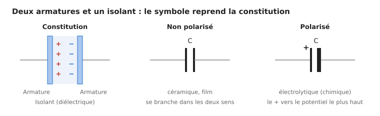
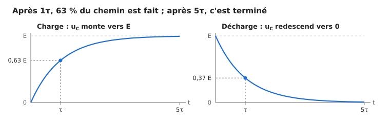
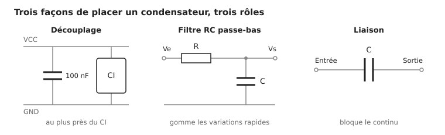

## Qu'est-ce qu'un condensateur ?

Un condensateur **stocke de l'énergie électrique sous forme de charges**, puis la restitue. C'est un composant de réserve, pas de consommation.

Il est constitué de deux plaques conductrices (les armatures) séparées par un isolant (le diélectrique). Le courant ne traverse jamais l'isolant : les charges s'accumulent sur les armatures, + d'un côté, − de l'autre.

Unité : le farad (F). En pratique on manipule des pF, des nF et des µF (1 µF = 10⁻⁶ F).

| Type | Valeurs typiques | Polarisé ? | Usage |
|---|---|---|---|
| Céramique | 10 pF à 10 µF | Non | Découplage, haute fréquence, filtres |
| Électrolytique (chimique) | 1 µF à 10 000 µF | Oui | Réservoir d'alimentation, lissage |

!!! warning
    Un condensateur électrolytique branché à l'envers peut chauffer et éclater. Toujours repérer la bande « − » sur le boîtier avant de le câbler.

## L'analogie du réservoir d'eau

| Électricité | Hydraulique |
|---|---|
| Condensateur | Réservoir d'eau |
| Capacité $C$ | Largeur du réservoir : plus il est large, plus il contient d'eau pour une même hauteur |
| Tension $U$ | Hauteur d'eau dans le réservoir |
| Charge $Q$ | Volume d'eau stocké |
| Courant $i$ | Débit dans le tuyau |
| Résistance $R$ | Étroitesse du robinet |

Remplir un réservoir prend du temps : **la tension aux bornes d'un condensateur ne peut pas varier instantanément**. Toutes les applications du condensateur découlent de cette propriété.

## L'essentiel en trois formules

Charge stockée : $Q = C \cdot U$ avec Q en coulombs (C), C en farads (F) et U en volts (V).

Relation courant–tension : $i = C \cdot \frac{du}{dt}$. Le courant n'existe que si la tension varie. Tension constante : courant nul, le réservoir est plein.

Constante de temps d'un circuit RC : $\tau = R \cdot C$ en secondes. Exemple : 10 kΩ × 100 µF = 1 s.

Pour aller plus loin, l'énergie stockée vaut $E = \frac{1}{2} \cdot C \cdot U^2$ (en joules).

## Charge et décharge d'un circuit RC

Un condensateur se charge vite au début, puis de plus en plus lentement. **Il est considéré comme plein après 5τ.**

Analogie : on remplit une bouteille avec un tuyau branché sous un château d'eau. Au début, la différence de niveau est grande et l'eau coule fort. Plus la bouteille se remplit, plus la différence diminue et plus le débit ralentit.

| Temps | Charge (% de E) | Décharge (% restant) |
|---|---|---|
| 1τ | 63 % | 37 % |
| 2τ | 86 % | 14 % |
| 3τ | 95 % | 5 % |
| 5τ | \> 99 % | &lt; 1 % |

- À 1τ, le condensateur est chargé à environ 2/3 : c'est ainsi qu'on mesure τ à l'oscilloscope.
- À la mise sous tension, un condensateur vide se comporte comme un **fil** (court-circuit).
- Après 5τ, le régime transitoire est terminé : il se comporte comme un **interrupteur ouvert** (plus de courant).

## Les montages principaux

| Montage | Rôle | Analogie |
|---|---|---|
| Découplage (100 nF entre VCC et GND) | Fournit les pics de courant, absorbe les parasites | Le verre d'eau sur le bureau : pas besoin de courir au robinet à chaque gorgée |
| Lissage (chimique 100 à 1000 µF) | Transforme une tension ondulée en tension quasi continue | Le château d'eau qui régularise la pression |
| Filtre RC passe-bas | Laisse passer les signaux lents, atténue les rapides (anti-rebond, PWM vers analogique) | L'amortisseur de voiture qui gomme les petites bosses |
| Temporisation (RC + comparateur ou NE555) | Crée un retard réglable (minuterie, reset d'un microcontrôleur) | Le sablier : le goulot (R) et la quantité de sable (C) fixent la durée |
| Liaison (C en série) | Bloque le continu, laisse passer l'alternatif (entrée audio) | La membrane qui transmet les vibrations mais pas la pression constante |

Fréquence de coupure du filtre RC passe-bas : $f_c = \frac{1}{2 \pi R C}$

Règle de pro : un condensateur de découplage de 100 nF par circuit intégré, placé au plus près de ses broches d'alimentation.

## Vérifier ses connaissances

!!! consigne
    1. Calculer la constante de temps d'un circuit avec R = 4,7 kΩ et C = 220 µF.
    2. Au bout de combien de temps ce condensateur est-il considéré comme chargé ?
    3. Pourquoi place-t-on un condensateur de 100 nF à côté de chaque circuit intégré ?
    4. Calculer la fréquence de coupure d'un filtre RC avec R = 1 kΩ et C = 100 nF.

<!-- zone: 10 -->

## À retenir

- Un condensateur est un réservoir de charges : sa tension ne peut pas varier instantanément.
- Formules : $Q = C \cdot U$, $i = C \cdot \frac{du}{dt}$, $\tau = R \cdot C$.
- Chargé à 63 % après 1τ, considéré comme plein après 5τ.
- Vide : il se comporte comme un fil. Plein : comme un interrupteur ouvert.
- 100 nF de découplage sur chaque circuit intégré ; respecter la polarité des chimiques.
