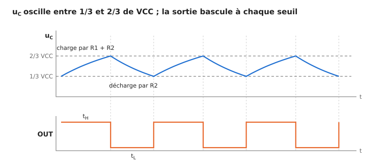
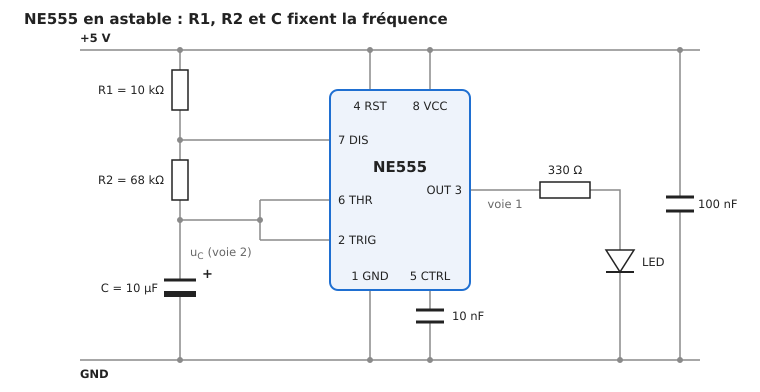

## Objectif et matériel

Réaliser un signal d'horloge d'environ 1 Hz avec un NE555, mesurer sa période à l'oscilloscope, puis la modifier en changeant uniquement le condensateur.

- NE555 (boîtier DIP8), plaque d'essai, alimentation 5 V
- R1 = 10 kΩ, R2 = 68 kΩ, R = 330 Ω, une LED
- Condensateurs : 10 µF (chimique), 1 µF, 100 nF, 10 nF
- Oscilloscope 2 voies, buzzer passif, carte Arduino (prolongement)

## Principe du montage astable

Le NE555 surveille la tension $u_C$ du condensateur et bascule entre deux seuils :

1. Le condensateur se charge à travers R1 + R2 : la sortie est à l'état haut.
2. Quand $u_C$ atteint 2/3 de VCC, la sortie passe à l'état bas et le condensateur se décharge à travers R2 (broche 7).
3. Quand $u_C$ redescend à 1/3 de VCC, la sortie repasse à l'état haut : le cycle recommence indéfiniment.



Analogie : la chasse d'eau automatique. Le réservoir se remplit lentement (charge), se vide d'un coup au niveau haut (décharge), puis recommence. La taille du réservoir (C) et le débit du robinet (R) fixent le rythme.

## Préparation : calculs

Formules du constructeur :

$$
t_H = 0{,}693 \cdot (R_1 + R_2) \cdot C
$$

$$
t_L = 0{,}693 \cdot R_2 \cdot C
$$

$$
f = \frac{1{,}44}{(R_1 + 2 R_2) \cdot C}
$$

!!! consigne
    Avec R1 = 10 kΩ, R2 = 68 kΩ et C = 10 µF, calculer $t_H$, $t_L$, la période T et la fréquence f.

<!-- zone: 6 -->

## Câblage



| Broche | Nom | Branchement |
|---|---|---|
| 1 | GND | Masse |
| 2 | TRIG | Reliée à la broche 6 |
| 3 | OUT | 330 Ω + LED vers la masse ; voie 1 de l'oscilloscope |
| 4 | RESET | VCC (sinon le 555 reste bloqué) |
| 5 | CTRL | 10 nF vers la masse (anti-parasites) |
| 6 | THR | Point commun R2 / C ; voie 2 de l'oscilloscope |
| 7 | DIS | Point commun R1 / R2 |
| 8 | VCC | +5 V ; 100 nF vers la masse, au plus près du boîtier |

!!! consigne
    Câbler le montage sur la plaque d'essai.

!!! warning
    Faire vérifier le câblage par le professeur avant la mise sous tension. Le − du condensateur chimique va à la masse.

## Mesures

!!! consigne
    1. Observer la LED : compter les clignotements en 10 s et comparer à la fréquence calculée.
    2. Relever en même temps la sortie (broche 3) et $u_C$ (broche 6) à l'oscilloscope. Repérer les seuils 1/3 et 2/3 de VCC.
    3. Mesurer $t_H$ et $t_L$, compléter le tableau et calculer l'écart en %.

| C | f calculée | tH mesuré | tL mesuré | f mesurée | Écart (%) |
|---|---|---|---|---|---|
| 10 µF | ______________ | ______________ | ______________ | ______________ | ______________ |
| 1 µF | ______________ | ______________ | ______________ | ______________ | ______________ |
| 100 nF | ______________ | ______________ | ______________ | ______________ | ______________ |

## Influence du condensateur

!!! consigne
    1. Remplacer C par 1 µF puis par 100 nF et compléter le tableau ci-dessus.
    2. Que devient la fréquence ? Pourquoi la LED semble-t-elle allumée en permanence ?
    3. Avec 100 nF, remplacer la LED par le buzzer : on entend l'horloge.

<!-- zone: 6 -->

## Questions de synthèse

!!! consigne
    1. Pourquoi $t_H$ est-il toujours un peu plus long que $t_L$ ?
    2. La tolérance d'un condensateur chimique est souvent de ±20 %. Quelle conséquence sur la précision de l'horloge ? Pourquoi un microcontrôleur utilise-t-il plutôt un quartz ?
    3. Proposer une valeur de C pour obtenir 0,5 Hz avec les mêmes résistances.

<!-- zone: 10 -->

## Correction avec l'oscilloscope virtuel

La correction du TP se fait avec l'activité **Oscilloscope virtuel NE555** de la séquence, en mode « Synthèse guidée » : six étapes de 5 minutes qui règlent le simulateur et affichent la question puis la correction.

## Prolongement : mesurer la fréquence avec un Arduino

La sortie du NE555 (broche 3) est reliée à la broche D2 de l'Arduino, masses communes. Le programme compte les fronts montants par interruption pendant une seconde.

```cpp
// NE555 clock frequency meter
// Wiring: NE555 output (pin 3) -> Arduino D2, common ground.
// Counts rising edges with an interrupt and prints the frequency every second.

const uint8_t CLOCK_PIN = 2;            // D2 = external interrupt INT0 on Uno/Nano
const unsigned long WINDOW_MS = 1000UL; // Measurement window (ms)

volatile unsigned long edgeCount = 0;   // Shared with the ISR: must be volatile

// Interrupt service routine: keep it as short as possible
void onRisingEdge()
{
    edgeCount++;
}

void setup()
{
    pinMode(CLOCK_PIN, INPUT);
    Serial.begin(9600);
    attachInterrupt(digitalPinToInterrupt(CLOCK_PIN), onRisingEdge, RISING);
}

void loop()
{
    static unsigned long lastTime = 0;
    const unsigned long now = millis();

    if (now - lastTime >= WINDOW_MS)
    {
        // Read and reset the counter atomically
        noInterrupts();
        const unsigned long count = edgeCount;
        edgeCount = 0;
        interrupts();

        const float frequency = count * 1000.0f / (now - lastTime);
        lastTime = now;

        Serial.print("f = ");
        Serial.print(frequency, 1);
        Serial.println(" Hz");
    }
}
```

!!! consigne
    1. Téléverser le programme et ouvrir le moniteur série (9600 bauds).
    2. Avec C = 100 nF, comparer la fréquence affichée à la mesure de l'oscilloscope.
    3. Avec C = 10 µF, la mesure est-elle précise ? Proposer une amélioration du programme.

<!-- zone: 6 -->
