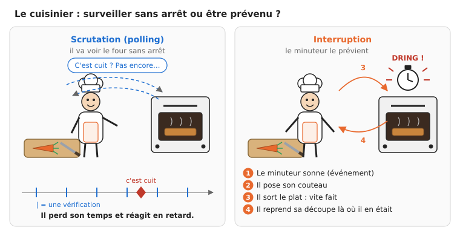
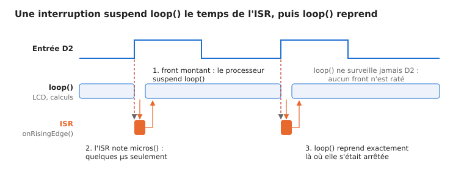

## Le problème

Dans le capacimètre de l'étape 5, le programme passe son temps à lire D2 pour ne pas rater un front. Cette méthode s'appelle la **scrutation** (polling). Pendant ce temps, il ne peut ni lire un bouton ni rafraîchir l'écran, et s'il n'y a plus de signal, il attend indéfiniment.

Une **interruption** inverse le problème : c'est le matériel qui prévient le programme quand l'événement se produit.

## L'analogie du cuisinier



Le cuisinier qui ouvre son four toutes les 10 minutes perd son temps, et si le plat est cuit juste après une vérification, il le sort en retard. Avec un minuteur, il travaille tranquillement sur ses légumes. Quand la sonnerie retentit, il pose son couteau, sort le plat, puis reprend exactement là où il s'était arrêté.

## Le vocabulaire

| En cuisine | Microcontrôleur | Arduino |
|---|---|---|
| Préparer les légumes | Programme principal | loop() |
| Le minuteur sonne | Événement matériel | Front montant sur D2 |
| Poser le couteau | Sauvegarde du contexte | Automatique |
| Sortir le plat, vite | Routine d'interruption (ISR) | onRisingEdge() |
| Reprendre la découpe | Retour d'interruption | Automatique |
| L'ardoise où il note l'heure | Variable partagée | volatile unsigned long |
| « Ne pas déranger » pendant qu'il lit l'ardoise | Section critique | noInterrupts() … interrupts() |

## Ce qui se passe dans le temps



L'ISR ne dure que quelques microsecondes. loop() est suspendue si peu de temps qu'elle ne s'en aperçoit pas, et aucun front n'est raté, même pendant un affichage ou un delay().

## Mettre en place une interruption sur Arduino

Sur un Arduino Uno, seules les broches D2 et D3 peuvent déclencher une interruption externe. On associe une fonction à la broche dans setup() :

**attachInterrupt(digitalPinToInterrupt(2), onRisingEdge, RISING);**

| Mode | L'ISR est appelée… |
|---|---|
| RISING | à chaque front montant (BAS → HAUT) |
| FALLING | à chaque front descendant (HAUT → BAS) |
| CHANGE | à chaque changement d'état |
| LOW | tant que l'entrée est à l'état bas |

Exemple : la LED clignote dans loop() avec un delay(1000), et pourtant aucun front n'est perdu.

```cpp
// Minimal interrupt example: count rising edges on D2 while loop() blinks the built-in LED.
// The blinking never stops, yet no edge is missed.

const uint8_t CLOCK_PIN = 2;          // D2 = INT0 on Arduino Uno

volatile unsigned long edgeCount = 0; // Shared with the ISR: must be volatile

void onRisingEdge()                   // ISR: short, no Serial, no delay
{
    edgeCount++;
}

void setup()
{
    pinMode(CLOCK_PIN, INPUT);
    pinMode(LED_BUILTIN, OUTPUT);
    Serial.begin(9600);
    attachInterrupt(digitalPinToInterrupt(CLOCK_PIN), onRisingEdge, RISING);
}

void loop()
{
    digitalWrite(LED_BUILTIN, !digitalRead(LED_BUILTIN));   // main task: blink
    delay(1000);                                            // even a delay() misses nothing

    noInterrupts();                   // read a 4-byte variable safely
    const unsigned long count = edgeCount;
    edgeCount = 0;
    interrupts();

    Serial.print("Fronts en 1 s : ");
    Serial.println(count);
}
```

!!! warning "Les règles d'or de l'ISR"
    - Elle doit être **courte** : le cuisinier sort le plat, il ne prépare pas un gâteau.
    - Pas de delay(), de Serial.print() ni d'affichage LCD : ces fonctions sont lentes ou utilisent elles-mêmes des interruptions.
    - Une variable modifiée dans l'ISR est déclarée **volatile**. Sinon le compilateur peut en garder une copie et ne jamais voir le changement.
    - On lit une variable de plus d'un octet entre noInterrupts() et interrupts(). L'ATmega328 est un processeur 8 bits : il lit un unsigned long en 4 fois. Si l'interruption tombe au milieu, on obtient une valeur moitié ancienne, moitié nouvelle.

## Vérifier ses connaissances

!!! consigne
    1. Pourquoi le cuisinier qui ouvre son four régulièrement peut-il rater la cuisson ? Quel est l'équivalent en programmation ?
    2. Quelles broches d'un Arduino Uno peuvent déclencher une interruption externe ?
    3. Pourquoi ne faut-il pas appeler lcd.print() dans une ISR ?
    4. Avec l'activité **Oscilloscope virtuel NE555**, régler C = 10 nF. Combien d'interruptions par seconde le capacimètre reçoit-il ? Si l'ISR dure 5 µs, quelle part du temps le processeur y passe-t-il ?
    5. Que risque-t-on si on oublie le mot-clé volatile ?

<!-- zone: 10 -->

## À retenir

- Scrutation : le programme surveille lui-même l'entrée. Simple, mais il est bloqué et peut rater des événements.
- Interruption : le matériel appelle une fonction (ISR) au moment de l'événement, puis le programme reprend.
- Sur Uno : attachInterrupt(digitalPinToInterrupt(2 ou 3), isr, RISING / FALLING / CHANGE).
- ISR courte, variables partagées volatile, lecture protégée par noInterrupts() / interrupts().
