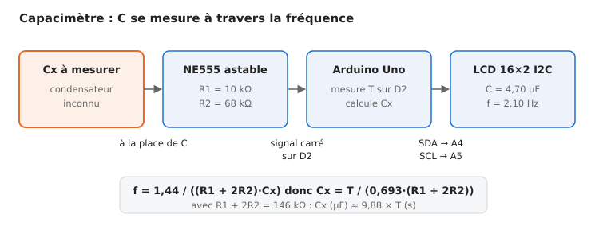
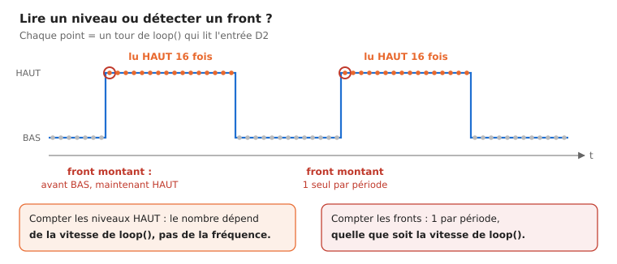

## Le besoin

On veut réaliser un appareil qui **affiche sur un écran LCD la valeur d'un condensateur**. Idée : on réutilise le NE555 astable du TP. Le condensateur inconnu Cx remplace C, la fréquence de l'horloge dépend alors de Cx. L'Arduino mesure la période et en déduit Cx.



| Exigence | Valeur |
|---|---|
| Grandeur mesurée | Capacité Cx d'un condensateur |
| Plage | 10 nF à 47 µF |
| Précision | ± 10 % |
| Affichage | LCD 16×2 : f sur la ligne 1, C avec son unité (nF ou µF) sur la ligne 2 |
| Rafraîchissement | Au moins une fois par seconde, même pour un grand condensateur |

## Étape 1 – Le lien entre f et C

!!! consigne
    Ouvrir l'activité **Oscilloscope virtuel NE555** de la séquence, en manipulation libre, avec R1 = 10 kΩ et R2 = 68 kΩ. Pour chaque valeur de C, relever f et calculer le produit C × f.

| C | f lue | C × f |
|---|---|---|
| 10 nF | ______________ | ______________ |
| 100 nF | ______________ | ______________ |
| 1 µF | ______________ | ______________ |
| 10 µF | ______________ | ______________ |
| 47 µF | ______________ | ______________ |

!!! consigne
    1. Que constatez-vous pour le produit C × f ?
    2. En déduire l'expression de C en fonction de f, puis de T. Comparer avec la formule $f = \frac{1{,}44}{(R_1 + 2R_2) \cdot C}$
    3. Quelle période doit-on mesurer pour un condensateur de 4,7 µF ?

<!-- zone: 6 -->

## Étape 2 – Première idée : lire l'entrée

Relier la sortie du NE555 (broche 3) à la broche D2 de l'Arduino, avec les masses communes. Ce premier programme compte combien de fois D2 est lue à l'état HAUT pendant une seconde :

```cpp
// Step 1 - Naive attempt: count how many times D2 is read HIGH during one second.
// Question: does this number really give the frequency of the NE555?

const uint8_t CLOCK_PIN = 2;             // NE555 output (pin 3) -> D2
const unsigned long WINDOW_MS = 1000UL;  // Counting window (ms)

void setup()
{
    pinMode(CLOCK_PIN, INPUT);
    Serial.begin(9600);
}

void loop()
{
    unsigned long count = 0;
    const unsigned long start = millis();

    while (millis() - start < WINDOW_MS)
    {
        if (digitalRead(CLOCK_PIN) == HIGH)
        {
            count++;
        }
    }

    Serial.print("Lu HAUT : ");
    Serial.print(count);
    Serial.println(" fois");
}
```

!!! consigne
    1. Téléverser le programme et ouvrir le moniteur série (9600 bauds).
    2. Relever le nombre affiché avec C = 1 µF, puis avec C = 10 µF.
    3. La fréquence a été divisée par 10. Le nombre affiché a-t-il été divisé par 10 ? Que compte réellement ce programme ?

<!-- zone: 16 -->

## Pourquoi détecter les fronts ?



Un tour de loop() dure quelques microsecondes. Pendant un état HAUT, l'entrée est donc lue des milliers de fois. Le compteur mesure la durée de l'état HAUT multipliée par la vitesse du programme, pas le nombre de périodes.

Un **front montant** n'existe qu'une seule fois par période. Pour le détecter, le programme doit **mémoriser l'état précédent** de l'entrée et le comparer à l'état actuel.

!!! consigne
    Compléter le tableau.

| État précédent | État actuel | Événement |
|---|---|---|
| BAS | BAS | Rien : l'entrée reste basse |
| BAS | HAUT | ______________ |
| HAUT | HAUT | ______________ |
| HAUT | BAS | ______________ |

## Étape 3 – Détecter les fronts et mesurer la période

Le programme suivant attend 11 fronts montants, mesure la durée de 10 périodes avec micros() et en fait la moyenne. La condition de détection est à écrire.

```cpp
// Step 2 - Rising edge detection by polling, period measurement with micros().
// Complete the TODO line, then compare the measured frequency with the calculation.

const uint8_t CLOCK_PIN = 2;     // NE555 output (pin 3) -> D2
const uint8_t PERIODS = 10;      // Number of periods averaged

void setup()
{
    pinMode(CLOCK_PIN, INPUT);
    Serial.begin(9600);
}

void loop()
{
    uint8_t edges = 0;
    unsigned long firstEdgeUs = 0;
    unsigned long lastEdgeUs = 0;
    int previous = digitalRead(CLOCK_PIN);

    // Wait for PERIODS + 1 rising edges (blocking loop)
    while (edges <= PERIODS)
    {
        const int current = digitalRead(CLOCK_PIN);

        if (false)   // TODO: replace 'false' by the rising edge condition (previous / current)
        {
            lastEdgeUs = micros();
            if (edges == 0)
            {
                firstEdgeUs = lastEdgeUs;
            }
            edges++;
        }
        previous = current;
    }

    const float periodUs = (lastEdgeUs - firstEdgeUs) / static_cast<float>(PERIODS);
    const float frequencyHz = 1.0e6f / periodUs;

    Serial.print("T = ");
    Serial.print(periodUs / 1000.0f, 3);
    Serial.print(" ms   f = ");
    Serial.print(frequencyHz, 2);
    Serial.println(" Hz");
}
```

!!! consigne
    1. Remplacer false par la condition de front montant, à l'aide du tableau ci-dessus.
    2. Pourquoi utilise-t-on micros() plutôt que millis() ?
    3. Mesurer f pour 100 nF, 1 µF et 10 µF et compléter le tableau.

| C | f calculée | f mesurée | Écart (%) |
|---|---|---|---|
| 100 nF | ______________ | ______________ | ______________ |
| 1 µF | ______________ | ______________ | ______________ |
| 10 µF | ______________ | ______________ | ______________ |

<!-- zone: 4 -->

## Étape 4 – Calculer C et l'afficher sur le LCD

| Broche du LCD I2C | Broche de l'Arduino Uno |
|---|---|
| GND | GND |
| VCC | 5V |
| SDA | A4 |
| SCL | A5 |

Bibliothèque : LiquidCrystal_I2C. L'adresse du module est en général 0x27 ou 0x3F.

!!! consigne
    1. Écrire le calcul de C à partir de la période : $C = \frac{T}{0{,}693 \cdot (R_1 + 2R_2)}$
    2. Afficher f sur la ligne 1 et C sur la ligne 2.
    3. Choisir l'unité automatiquement : nF en dessous de 1 µF, µF au-dessus. Aide : le caractère µ s'obtient avec lcd.write(0xE4).

<!-- zone: 6 -->

## Étape 5 – Les limites de la scrutation

!!! consigne
    1. Mesurer un condensateur de 47 µF. Combien de temps faut-il attendre le premier affichage ? Le cahier des charges est-il respecté ?
    2. Débrancher le fil de D2. Que se passe-t-il ? Pourquoi ?
    3. On veut ajouter un bouton HOLD qui fige l'affichage. Pourquoi est-ce impossible avec ce programme ?

<!-- zone: 6 -->

Le programme passe tout son temps à surveiller D2 : il ne peut rien faire d'autre. C'est le cuisinier qui reste planté devant son four. La solution est l'**interruption** : voir le cours « Les interruptions ».

## Étape 6 – Le capacimètre avec interruption

Après le cours, voici la version avec interruption. L'ISR se contente de noter la date de chaque front montant, loop() calcule et affiche toutes les 500 ms.

```cpp
// Step 4 - Interrupt-driven capacitance meter with a 16x2 I2C LCD.
// The ISR only timestamps rising edges; loop() computes and displays every 500 ms.
// Library: LiquidCrystal_I2C. Adjust the I2C address if needed (0x27 or 0x3F).

#include <Wire.h>
#include <LiquidCrystal_I2C.h>

const uint8_t CLOCK_PIN = 2;                   // D2 = INT0 on Arduino Uno
const float R1_OHM = 10000.0f;
const float R2_OHM = 68000.0f;
const float K = 0.693f * (R1_OHM + 2.0f * R2_OHM);   // T = K * C
const unsigned long DISPLAY_MS = 500UL;        // Display refresh period
const unsigned long TIMEOUT_US = 3000000UL;    // No edge for 3 s -> no signal

LiquidCrystal_I2C lcd(0x27, 16, 2);

// Shared with the ISR: volatile, and read with interrupts disabled
volatile unsigned long lastEdgeUs = 0;
volatile unsigned long periodSumUs = 0;
volatile unsigned int periodCount = 0;

// ISR: as short as possible, no Serial, no LCD, no delay
void onRisingEdge()
{
    const unsigned long now = micros();
    if (lastEdgeUs != 0)
    {
        periodSumUs += now - lastEdgeUs;
        periodCount++;
    }
    lastEdgeUs = now;
}

void printCapacitance(float farads)
{
    if (farads < 1.0e-6f)
    {
        lcd.print(farads * 1.0e9f, 1);
        lcd.print(" nF    ");
    }
    else
    {
        lcd.print(farads * 1.0e6f, 2);
        lcd.print(" ");
        lcd.write(0xE4);            // micro character of the HD44780 ROM
        lcd.print("F    ");
    }
}

void setup()
{
    pinMode(CLOCK_PIN, INPUT);
    lcd.init();
    lcd.backlight();
    lcd.print("Capacimetre");
    attachInterrupt(digitalPinToInterrupt(CLOCK_PIN), onRisingEdge, RISING);
}

void loop()
{
    static unsigned long lastDisplayMs = 0;

    if (millis() - lastDisplayMs < DISPLAY_MS)
    {
        return;                     // loop() stays free for other tasks (buttons, etc.)
    }
    lastDisplayMs = millis();

    // Critical section: copy and reset the shared variables atomically
    noInterrupts();
    const unsigned long sumUs = periodSumUs;
    const unsigned int count = periodCount;
    const unsigned long lastUs = lastEdgeUs;
    periodSumUs = 0;
    periodCount = 0;
    interrupts();

    if (count > 0)
    {
        const float periodUs = sumUs / static_cast<float>(count);
        lcd.setCursor(0, 0);
        lcd.print("f = ");
        lcd.print(1.0e6f / periodUs, 2);
        lcd.print(" Hz    ");
        lcd.setCursor(0, 1);
        lcd.print("C = ");
        printCapacitance(periodUs * 1.0e-6f / K);
    }
    else if (micros() - lastUs > TIMEOUT_US)
    {
        lcd.setCursor(0, 0);
        lcd.print("Pas de signal   ");
        lcd.setCursor(0, 1);
        lcd.print("                ");
    }
    // else: slow signal, less than one period in 500 ms -> keep the previous display
}
```

!!! consigne
    1. Repérer l'ISR, les variables volatile et la section critique.
    2. À quoi sert le test lastEdgeUs != 0 dans l'ISR ?
    3. Tester avec 47 µF puis sans signal. Les problèmes de l'étape 5 sont-ils résolus ?

<!-- zone: 6 -->

## Validation

!!! consigne
    Mesurer des condensateurs de valeur connue et compléter le tableau.

| Valeur marquée | Tolérance | Valeur affichée | Écart (%) |
|---|---|---|---|
| 10 nF | ______________ | ______________ | ______________ |
| 100 nF | ______________ | ______________ | ______________ |
| 1 µF | ______________ | ______________ | ______________ |
| 4,7 µF | ______________ | ______________ | ______________ |
| 10 µF | ______________ | ______________ | ______________ |
| 47 µF | ______________ | ______________ | ______________ |

!!! consigne
    1. Le cahier des charges (± 10 %) est-il respecté sur toute la plage ?
    2. Les résistances ont elles aussi une tolérance. Proposer une méthode d'étalonnage avec un condensateur de référence pour corriger la constante K du programme.

<!-- zone: 6 -->

Pour aller plus loin en projet : bouton HOLD, changement de calibre automatique en commutant les résistances, mesure en dessous de 1 nF (attention aux capacités parasites de la plaque d'essai).
