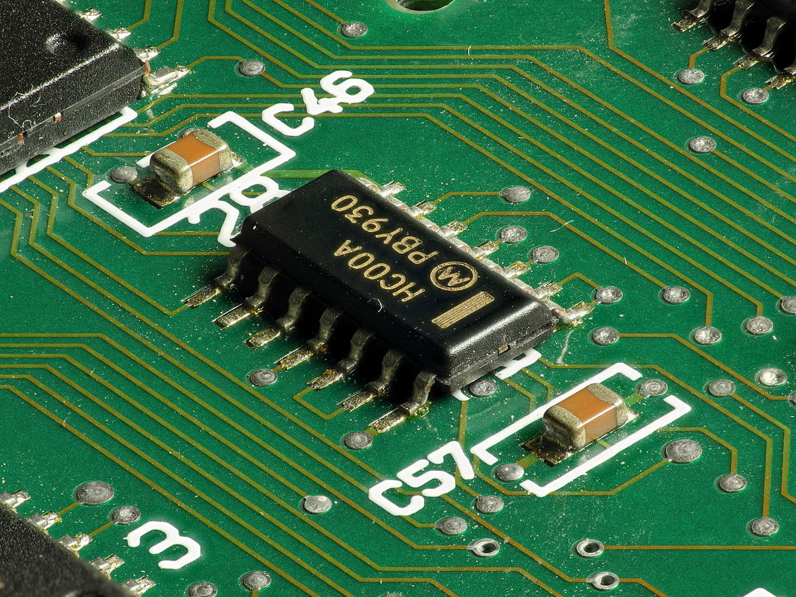
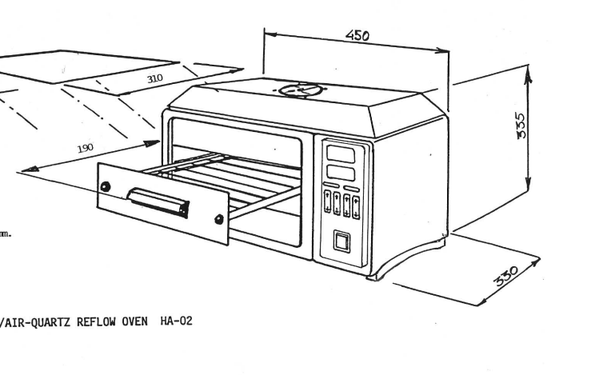
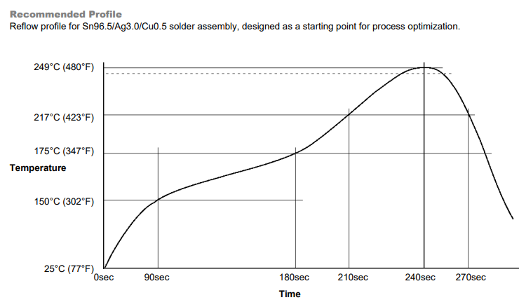

## Réalisation en 2 temps

1. Les CMS (Composants Montés en Surface) sont d'abord souder sur la carte à l'aide de pâte à braser et du four à refusion
2. Les composants traversants connecteurs.

!!! warning "Connecteurs en plastique à ne pas mettre au four"
    Ne pas mettre de connecteurs en plastique dans un four à refusion, s'il n'est pas prévu pour cela

## CMS et four à refusion

Le brasage et le soudage sont deux procédés utilisés pour assembler des matériaux dans différents secteurs industriels ou artisanaux, tels que la plomberie (tubes et raccords). Le brasage est une opération d'assemblage qui s'obtient par fusion d'un métal d'apport (par exemple à base d'argent ou étain) sans fusion du métal de base.

**CMS** : Composant Monté en Surface

Four HA02 à refusion

La refusion (reflow) est utilisée pour les cartes disposant de composants CMS. La pose de composants CMS sur une carte requiert une certaine minutie. Le circuit imprimé nu est d'abord sérigraphié :

les face du circuit imprimé sont enduites d'une **pâte à braser** seulement à l'emplacement des terminaisons des composants (on utilise un [http://www.ma-boite-a-archives.fr/BTS-SN/Cours/2015-2016/ActivitesEC2/Site_Four_refusion/co/6_grain_Pochoir_1.html](http://www.ma-boite-a-archives.fr/BTS-SN/Cours/2015-2016/ActivitesEC2/Site_Four_refusion/co/6_grain_Pochoir_1.html) /stencil pour cela)

Les composants sont ensuite posés sur le circuit.

Finalement le circuit passe dans un four où la chaleur fait fondre la pâte déposée pour former la brasure.

Les cartes électroniques actuelles sont très souvent équipées de composants sur leurs deux faces. Elles nécessitent donc deux passages sur la ligne de production : un pour chaque face.

La refusion doit se dérouler en plusieurs phases :

- **Attente** : température à laquelle le four se met par défaut, après mise sous tensions (généralement 90°C)

<!-- -->

- **Préchauffage** : Augmenter progressivement la température des composants et de la brasure

<!-- -->

- **Séchage** : Temps pour que le flux agisse et s'évapore complètement. Il doit durer 1 minute 30

<!-- -->

- **Refusion** : Fusion de la crème à braser et montée jusqu'à la température max qui doit être la température de fusion de la crème à braser + 20°C

<!-- -->

- **Refroidissement**

Cette caractéristique (courbe d'évolution de la température) varie en fonction de la crème à braser, il faut donc se référer à la doc de la crème à braser utilisée et programmer le four en fonction de la pâte utilisée. Lecture de la [doc](pate_a_braser_TS391SNL.pdf) de la pate utilisé au lycée.

## Matériaux

Alliage à base d'étain + Cuivre et/ou Argent, ou Bismut, ou plomb, ... + du Flux. Ce dernier attaque les pièces à braser (acide) rt14 A11 (no clean). Le flux cr2 est autre type de flux qu'il faut nettoyer avec une bombe spéciale.

Fils de Brasure :

- Ne pas acheter en grande surface

<!-- -->

- Cuivre argent Argent : résistance mécanique + forte

## Température du fer

Lecture des [read://https_eleshop.fr/?url=https%3A%2F%2Feleshop.fr%2Fknowledgebase%2Fbrasage-a-main%2F](read://https_eleshop.fr/?url=https%3A%2F%2Feleshop.fr%2Fknowledgebase%2Fbrasage-a-main%2F) de eleshop relatifs au brasage

Température des pannes de fer préconisé :

- pour soudure au plomb 310-320

<!-- -->

- **pour sans plomb 360 - 370**

Ne pas confondre puissance et température

Ne pas aller trop vite au niveau de la température car le flux est actif sur une plage de température assez faible, 130 à 160

Une soudure **peut prendre plusieurs secondes** sinon on risque der faire du collage peut fiable

pour les CMS Crème a fraser flux et microbille d'alliage qui fondent à la chaleur et assure la brasure

le mob39 flux pateux qui assure un maintient des composants et réutilise l'étain de la pastille. Bien pour la maintenance

Fournisseur BMJ elec
