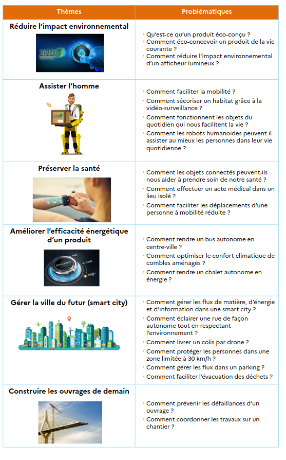

## Trouver des sujets de projet !

!!! consigne
    **Imprégnation** : Trouver un sujet de projet terminal. Le sujet doit s'inscrire dans les thématiques suivantes :

!!! consigne
    **Idéation** : Chaque groupe (4-5 élèves) réalise un brainstorming sur la recherche d'un projet possible en restant dans les thèmes sociétaux du développement durable. Vous devez pour cela :

    - Ne pas critiquer les idées
    - Penser et exprimer librement : Laisser libre cours à l'imagination, la spontanéité, la surprise et à l'inattendue
    - Tabler sur la quantité et produire un maximum d'idées
    - Trouver le plus d'idées possible jusqu'aux idées les plus farfelues
    - Développer les idées
    - Reprendre et construire sur les idées des autres : «Oui, et... ou «Oui et encore....» plutôt que «Oui, mais...
    - Combiner les idées : Mettre ensemble deux idées pour en créer une nouvelle

    1 secrétaire note les idées et les organise dans une carte mentale.

!!! consigne
    **Cristallisation** :

    - Réserver 2 idées par groupe.
    - Pour chaque idées énoncer les thèmes sociétaux du développement durable abordés.

!!! consigne
    **Matérialisation :** Présentation des deux sujets retenus face au groupe.

!!! warning
    Les groupes et les sujets que vous proposez n'ont rien à voir avec les groupes et sujets que vous aurez.
