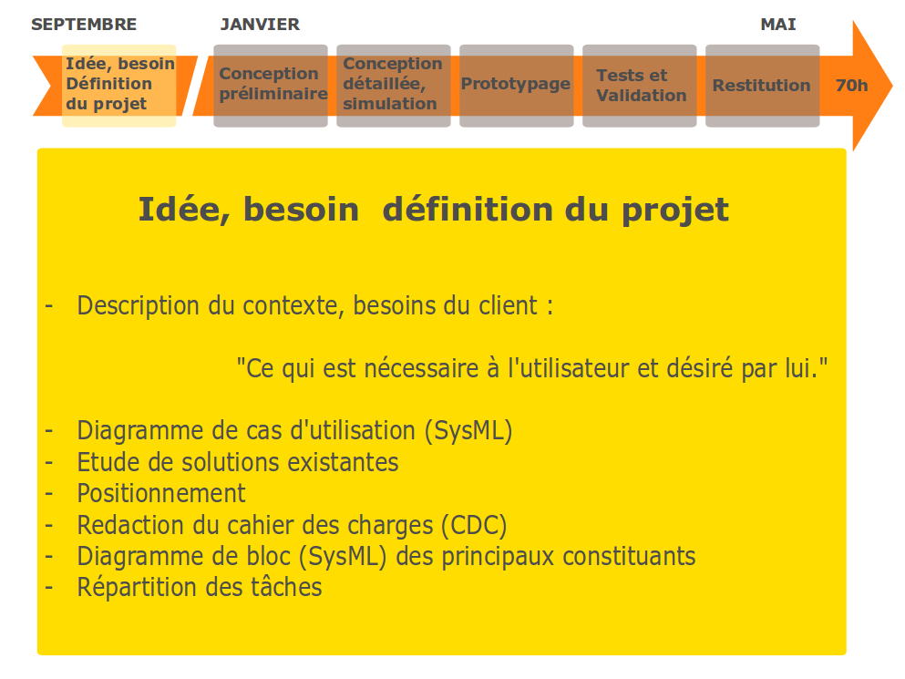

## 1. Définir le contexte

!!! consigne
    Vous devez rédiger un compte-rendu décrivant le contexte dans lequel votre projet s'inscrit.

    **Exemple** : Projet Simon dans l'aide à la recherche scientifique

    

!!! warning
    **Attention** à ne pas parler de solutions techniques mais juste du besoin exprimé par le client : Ce qui est nécessaire à l'utilisateur et désiré par lui. **Contre-exemple** :

    « Un `casque` muni d'une `électrode` mesure l'activité cérébrale d'une personne au volant d'un véhicule pour déterminer son niveau de concentration. Ce système a pour objectif de réduire les accidents dû a la déconcentration et à la somnolence au volant. Il pourra être utilisé autant chez les professionnels (Chauffeur routier, taxis) que chez les particuliers. »

    Dans ce paragraphe les solutions techniques (`casque` et `électrodes`) ne doivent pas apparaître.

## 2. Définir les exigences

!!! consigne
    Réaliser un premier diagramme des exigences du projet
