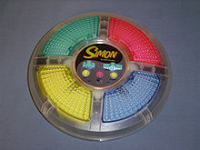

## Projet Simon

Dans cette série d'activités, la programmation des carte Arduino en C++ est approfondie en fixant comme objectif la reproduction du jeu Simon.

**Wikipedia** : "Le jeu, électronique, éclaire une des quatre couleurs et produit un son toujours associé à cette couleur. Le joueur doit alors appuyer sur la touche de la couleur qui vient de s'allumer dans un délai assez court.

Le jeu répète la même couleur et le même son, puis ajoute au hasard une nouvelle couleur. Le joueur doit reproduire cette nouvelle séquence. Chaque fois que le joueur reproduit correctement la séquence, le jeu ajoute une nouvelle couleur."

Les exigences du projet :

