## Matériel

**Breadboard**: Cette carte d'expérimentation permet de relier les composants entre eux grâce à des trous qui sont interconnectés ou pas. Les trous connectés correspondent aux lignes noires (cuivre) de la représentation ci dessus à droite.

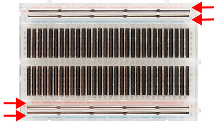

**Un bouton poussoir :**

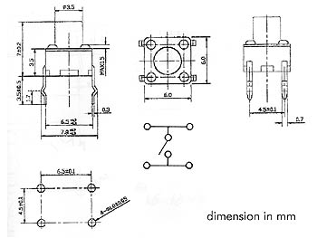

Une carte Arduino UNO permetra de contrôler l'état de la LED en fonction de l'état du bouton poussoir.

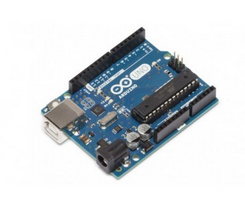

**LED Rouge**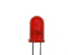

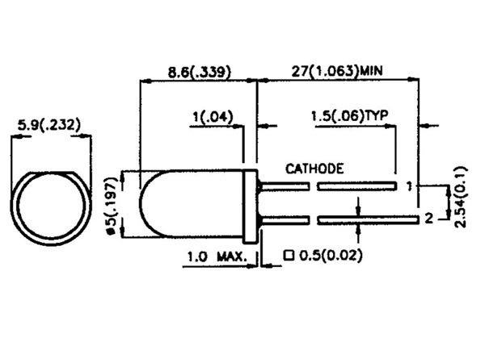

Deux **résistances**  : 10kΩ et 560Ω

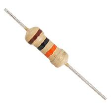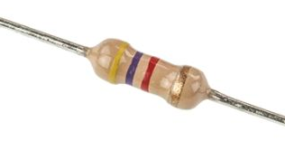

## Schéma structurel 1 LED + 1 BP

Avant de câbler l'ensemble on se concentrer ici sur une petite part. Une LED et un bouton poussoir reliés à la carte Arduino.


## Analyser

!!! consigne
    A quelles broches sont connectées la LED et le Bouton Poussoir.  Entrées ou sorties ?(remplir le tableau suivant).

    | Composants | Numéro de broches Arduino | Entrée ou sortie ? |
    |---|---|---|
    | LED |   |   |
    | BP |   |   |

!!! consigne
    Flécher sur le schéma la tension VIO2 et VIO3 correspondant aux tensions aux bornes des broche IO2 et IO3 de la carte Arduino.

!!! consigne
    Lorsque le BP est activé, que vaut VIO2 ?

<!-- zone: 1 -->

!!! consigne
    Lorsque le BP est inactif, que vaut VIO2 ?

<!-- zone: 2 -->

!!! consigne
    Quel est l'état de la LED lorsque VIO3 = 5V et quel est la valeur de l'intensité du courant dans la LED (Vd= 1,7 V?

<!-- zone: 2 -->

??? solution "Solution"
    LED : broche 3, sortie

    BP : broche 2, entrée

    Lorsque le BP est activé, que vaut VIO2 = 5V

    Lorsque le BP est inactif, que vaut VIO2 = 0V

    Quel est l'état de la LED lorsque VIO3 = 5V et quel est la valeur de l'intensité du courant dans la LED ?

    $$
    VR = VIO3 - VD = 5 - 1,7 = 3.3 V
    $$

    $$
    I = \frac{VR}{R} = \frac{3.3}{560} = 5.89 mA
    $$

## Câbler

!!! consigne
    Proposer un câblage ci-dessous :

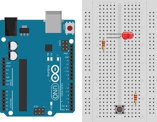

??? solution "Solution"
    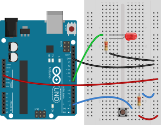

## Programme 1 : compter le nombre d'appuis

Dans un premier temps et pour comprendre le phénomène de rebonds, nous allons essayer de programmer un premier programme qui initialise un variable entière à 0 et ajoute 1 (incrémentation) lorsque le bouton poussoir est appuyé.

Lors de l'exécution du programme il est possible d'envoyer et de recevoir des informations au PC grâce à la liaison série.

Dans le programme, un objet nommé **Serial** doit être initialisé **Serial.begin(9600)** à une vitesse comprise entre **9600** et **115200** bauds (Nombre de symboles transmis par secondes). Puis une méthode **println("Bonjour")** permet d'envoyer les informations.

!!! consigne
    Tester le programme suivant :

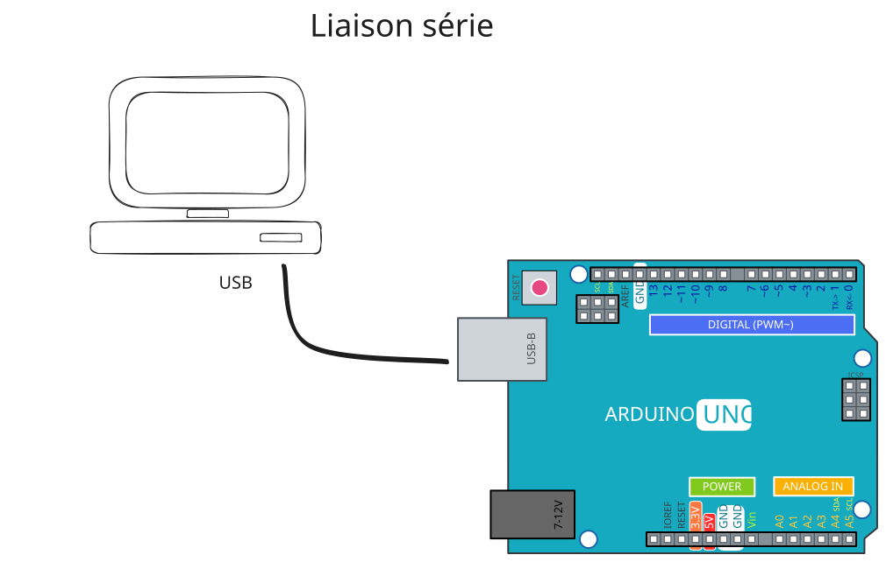

```cpp
/*
 * Dans cet exemple, une variable compteur est initialisee a 0
 */

int compteur = 0;

void setup() {
    Serial.begin(9600); // Initialise la transmission a 9600 Bauds
}

void loop() {
    Serial.println("Compteur =");  // Afficher la chaine de caracteres
    Serial.println(compteur);      // Afficher la variable compteur
    compteur = compteur + 1;       // Incrementer
    delay(1000);                   // Attendre 1s
}
```

## Programme 1

On souhaite créer un programme permettant d'afficher le nombre de fois que l'on a appuyé sur le bouton poussoir.

!!! consigne
    Réaliser l'organigramme (voir cours) du programme Arduino correspondant (SETUP et LOOP) :

<!-- zone: 14 -->

!!! consigne
    Dans l'environnement Arduino, à partir de l'exemple, écrire un programme correspondant à l'organigramme ci-dessus et le tester.

!!! consigne
    Que constate-t-on ?

<!-- zone: 2 -->

??? solution "Solution"
    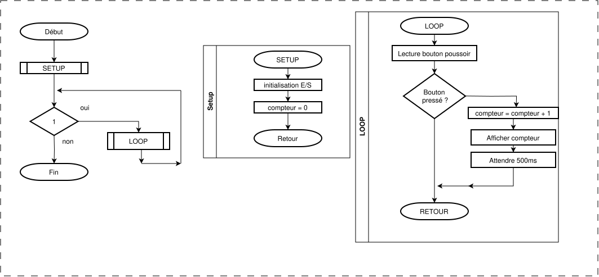

    ```cpp
    /*
     * Premiere approche pour compter le nombre d'appuis
     */

    int compteur = 0;
    // broches 

    const int LED = 3; // LED sur broche 3
    const int BP  = 2; // BP  sur broche 2

    void setup() {
        pinMode(LED, OUTPUT); // Initizliser E/S numeriques
        pinMode(BP,  INPUT );

        Serial.begin(9600); // Initialise la transmission a 9600 Bauds
    }

    void loop() {
        int etat = digitalRead(BP); // lecture BP
        if(etat == 1)               // Si Appui
        {
          compteur = compteur + 1;       // Incrementer compteur 
          Serial.print("Compteur =");    // Afficher la chaine de caracteres
          Serial.println(compteur);      // Afficher la variable compteur
          delay(500);                    // Attendre 500ms
        }
     }
    ```

    On constate que lorsque que l'on reste appuyé sur le bouton le compteur compte, alors que l'on souhaite compter le nombre d'appuis.

!!! reminder "Boucle while"
    La boucle **while** permet d'exécuter des instructions jusqu'à ce qu'une certaine expression (à l'intérieur de la parenthèse) devienne fausse. Autrement dit, tant que le test est vérifié, on répète les instructions entre accolade :

    ```cpp
    while(Var < 50)//
    {
      // Traitement
    }
    ```

    

## Boucle tant que BP appuyé

La solution proposée ici consiste dans la fonction **loop** à :

\- Tester si il y un appui

\- S'il y a un appui on incrémente **compteur** et on attend le relâchement du **BP.**

Attendre le relâchement du **BP** peut se faire en utilisant une boucle TANT QUE dans laquelle on lit l'état du BP. On reste dans cette boucle tant que le **BP** est activé.

## Programme 2

!!! consigne
    Réaliser l'organigramme du nouveau programme Arduino avec boucle de gestion du relâchement du bouton :

<!-- zone: 15 -->

!!! consigne
    Programmer et tester cette solution sur votre carte.

!!! consigne
    Que constate-t-on ?

<!-- zone: 2 -->

??? solution "Solution"
    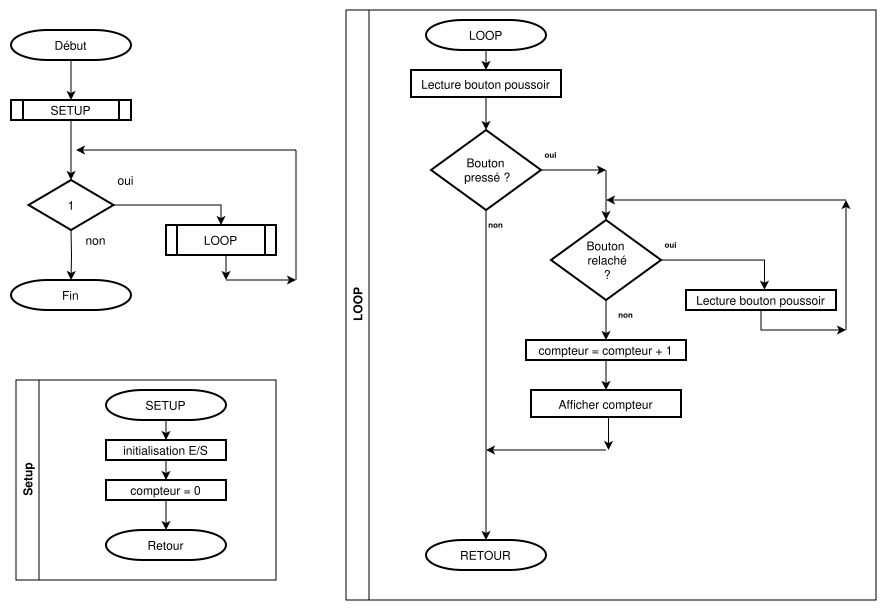

    ```cpp
    /*
     * Seconde approche pour compter le nombre d'appuis
     * le comptage s'effectue au relachement du bouton poussoir BP
     */

    int compteur = 0;
    // broches

    const int LED = 3;  // LED sur broche 3
    const int BP  = 2;  // BP  sur broche 2

    void setup() {
      pinMode(LED, OUTPUT);  // Initizliser E/S numeriques
      pinMode(BP, INPUT);

      Serial.begin(9600);  // Initialise la transmission a 9600 Bauds
    }

    void loop() {
      int etat = digitalRead(BP);  // lecture BP
      if (etat == 1)               // Si Appui
      {
        while (etat == 1) {
          etat = digitalRead(BP);
        }
        compteur = compteur + 1;     // Incrementer compteur
        Serial.print("Compteur =");  // Afficher la chaine de caracteres
        Serial.println(compteur);    // Afficher la variable compteur
     }
    }
    ```

## Délais anti-rebonds

Pour se prémunir des rebonds une solution consiste à insérer un délais après chaque lecture du bouton poussoir :


!!! consigne
    Réaliser l'organigramme du nouveau programme Arduino avec les délais anti-rebonds adéquats :

<!-- zone: 15 -->

!!! consigne
    Programmer et tester cette solution sur votre carte.

## Exercice

??? solution "Solution"
    ```cpp
    int compteur = 0; // Initialiser le compteur

    void setup() // Executer une fois
    {
      pinMode(2, OUTPUT); // LED en sortie sur la broche 2
      pinMode(3, INPUT);  // BP en entree sur la broche 3
      Serial.begin(9600); // Terminal Serie a 9600 bauds
    }

    void loop() // Boucle infini 
    {

      if (digitalRead(3) == 1) // Si Appui sur BP
      {
        while (digitalRead(3) == 1) { // Tant que BP est appuye
          delay(100); // Delais anti-rebond
        }
        compteur = compteur + 1;  // incrementer compteur
        Serial.println(compteur); // afficher compteur
      }
    }
    ```
