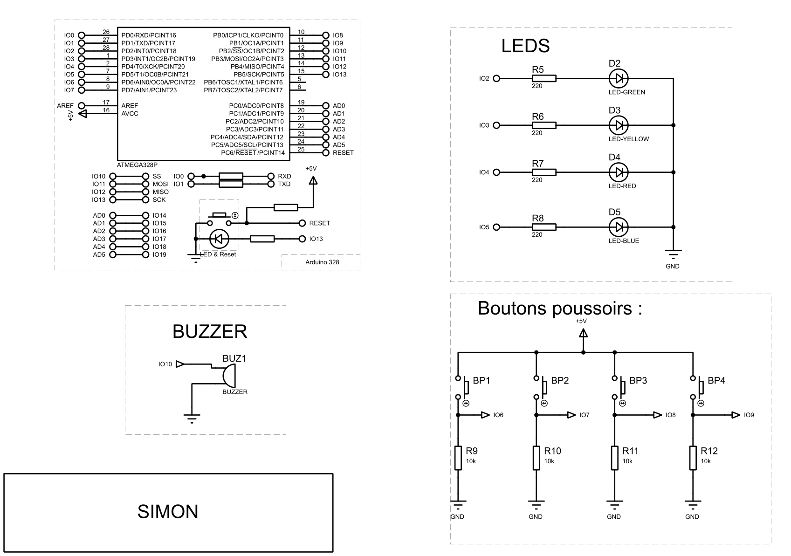
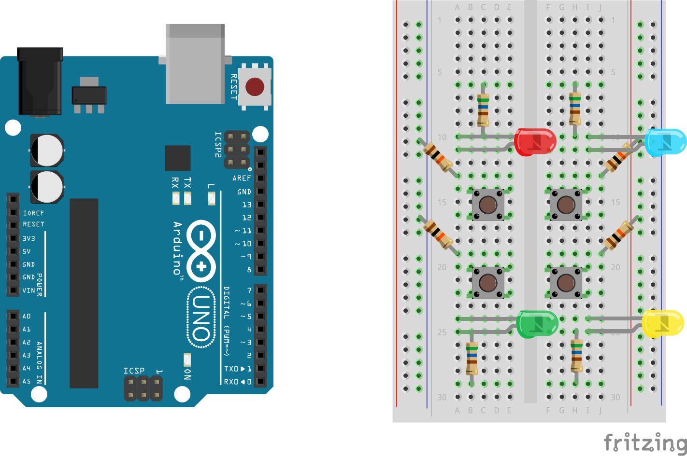

!!! info
    **Analyse du****schéma structurel :**

    D'après le schéma structurel ci après, répondre aux questions suivantes :

    !!! consigne
        Quelles  broches doivent être configurées en entrée ? justifier.

    <!-- zone: 4 -->

    !!! consigne
        Quelles  broches doivent être configurées en sortie ? justifier.

    <!-- zone: 4 -->

    

!!! info
    **Câblage :**

    !!! consigne
        Compléter le câblage des composants ci-dessous

    

!!! info
    **Programmation** : L'objectif est ici de tester le câblage des composants ci-dessus :

    !!! consigne
        **Test des LEDS :**

        - Réaliser un programme Arduino permettant, toutes les 500ms, de faire clignoter les 4 LED.
