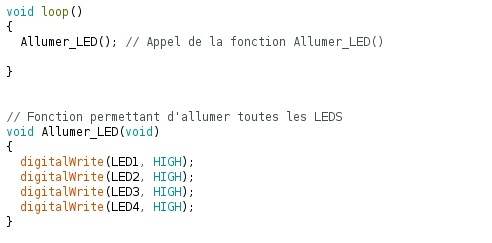
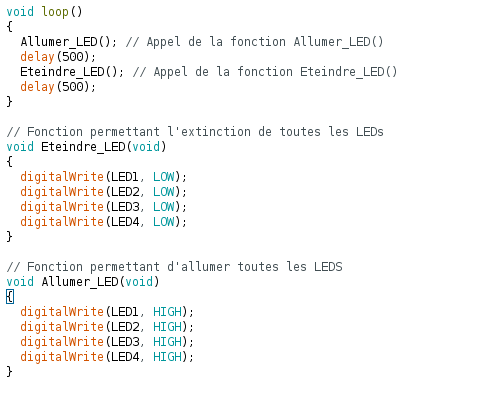
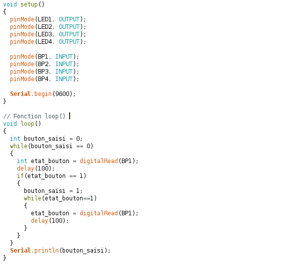

## Blink avec 4 LED

!!! info
    Dans cette première partie nous allons reprendre le programme de test qui permettait de faire clignoter les 4 LEDs et l'alléger un peu. Pour se faire nous allons définir une fonction **Allumer_LED()** que nous pourrons appeler à tout moment dans notre programme. La définition de cette fonction (son écriture) pourra se situer après la fonction **loop() :**

    

    !!! consigne
        Modifier le programme de test des 4 LEDs en ajoutant la fonction **Allumer_LED()** comme ci-dessus.

## Fonction : Eteindre_LED()

Ecrire une seconde fonction sur le même principe, permettant l'extinction des 4 LED et compléter la fonction **loop()** pour permettre le clignotement de ces 4 LEDs.

??? solution "Solution"
    

    [Télécharger le programme](simon_foncitons1.ino)

## Détecter le bouton appuyé par l'utilisateur

!!! info
    A partir du programme précédent nous allons réécrire la fonction **loop().** Dans cette fonction le programme interrogera chaque entrée pour déterminer s'il y a eu un appui ou non. Nous allons donc répéter une opération de lecture pour chaque bouton poussoir. Cette procédure sera assez semblable à la première activité (comptage du nombre d'appuis sur le BP). Pour le premier bouton poussoir elle peut s'écrire ainsi :

    

!!! warning
    Ce n'est qu'un extrait du programme. Il faut évidemment déclarer les constantes avant le **setup()**.

!!! info
    Ce premier programme nous permet juste d'afficher 1 sur le terminal série lorsque le Bouton poussoir poussoir 1 est actionné.

    !!! consigne
        Ajouter dans le **while()** un bloc d'instruction permettant au programme d'afficher le numéro du bouton poussoir actionné par l'utilisateur.

    <!-- zone: 4 -->
