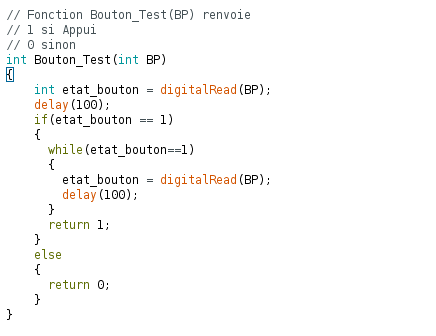

!!! info
    Un premier programme de gestion des boutons poussoirs est donné [ici.](simon_foncitons2.ino)

    !!! consigne
        Ouvrir le programme à l'aide du logiciel Arduino

    **Description du programme :**

    Dans la première partie du programme le numéro des broches auxquelles sont connectés les différents éléments (LED et Boutons Poussoirs) sont définis. Ensuite, dans la fonction **setup()** les broches des LED sont configurées en sortie et les broches des boutons poussoirs en entrée.

    Dans la fonction **loop()** une variable **bouton_saisie** est défini. Elle représente l’identifiant (1, 2, 3 ou 4) du bouton qui a été pressé par l'utilisateur. Cette variable à 0 indique que l'utilisateur n'a appuyé sur aucun bouton.

    **bouton_saisi** est donc initialisé à 0 et on réalise ensuite une boucle **while** : tant que bouton_saisi reste à 0 (qu'il n'y a eu aucune saisie). Dans cette boucle les procédures suivantes sont donc répétées :

    - Lecture de l'état de l'entrée **BP1** avec delay anti-rebonds

    <!-- -->

    - Si l'état est à un :

      - on affecte **bouton_saisie** à 1 (BP1)

      - tant que **état == 1 :**

        - Lecture de l'**état** de l'entrée **BP1** avec delay anti-rebonds

    - Lecture de l'état de l'entrée **BP2** avec delay anti-rebonds

    - ...

    - idem

    Pour chaque Bouton poussoir la même procédure est répétée 4 fois. Nous allons donc créer un fonction appelé **Bouton_Test(BP)** :

    

    !!! consigne
        Que réaliser cette fonction ?

    <!-- zone: 6 -->

    !!! consigne
        A partir de cette fonction, modifier le programme précédent en allégeant la fonction loop().

    On souhaite alléger encore la fonction loop en définissant une fonction plus globale gérant les 4 boutons poussoirs à la fois : int **Scan_Boutons**(void)

    Cette fonction doit renvoyer un entier indiquant quelle bouton poussoir à été appuyé.

    !!! consigne
        Ecrire cette nouvelle fonction et réduire la fonction loop à sa plus simple expression.

## SOLUTION

!!! info
    Solution [ici](simon_foncitons_corrections.ino)

    <!-- zone: 2 -->
