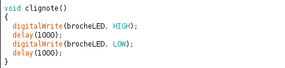
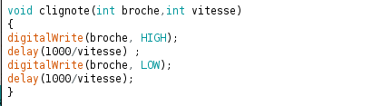
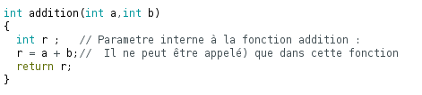
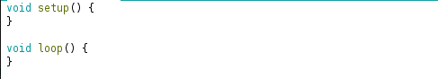

!!! info
    Une fonction (également désignée sous le nom de procédure ou de sous-routine) est un bloc d'instructions que l'on peut appeler à tout endroit du programme. Le langage Arduino est constitué d'un certain nombre de fonctions, par exemple a**nalogRead(), digitalWrite()** ou **delay()**. Il est possible de déclarer ses propres fonctions par exemple :

    

    Tout ce qui se trouve entre accolades fait parti de la fonction clignote. Pour exécuter cette fonction, il suffit de taper la commande **clignote();**

## Les paramètres d'entrée

!!! info
    On peut faire intervenir un ou des paramètres en entrée dans une fonction :

    

    La fonction clignote comporte 2 paramètres d'entrée : broche et vitesse. Le types des paramètres d'entrée doivent être définis, ici se sont des **int**.

    Dans ce cas, on peut moduler leurs valeurs depuis la commande qui l'appelle :

    

## Le paramètre de sortie

!!! info
    On peut faire intervenir un paramètres en sortie également dans une fonction :

    

    La fonction addition comporte 2 paramètres d'entrée **a** et **b** qui sont des entiers (**int**). **r** représente le résultat de la fonction addition. Sa valeur est retournée par la fonction.

    L'utilisation dans un programme peut être ainsi :

    

## Le type void

!!! info
    Le type **void** en C et en C++ est l'équivalent de l'ensemble vide. Lorsqu'une fonction ne renvoie aucun argument (pas de **return**) alors on déclare un type **void** comme paramètre de sortie, pour dire qu'elle ne renvoie rien. C'est le cas des fonction **loop** et **setup()** :

    

## Simuler Arduino sur TinkerCAD

!!! info
    !!! consigne
        Réaliser un programme avec la fonction void clignote() ci-dessus.

    !!! consigne
        Réaliser un programme affichant au terminal série le résultat de l'addition de deux entier préalablement définis en utilisant la fonction **int addition(int a, int b)** ci-dessus.

    <!-- zone: 3 -->
