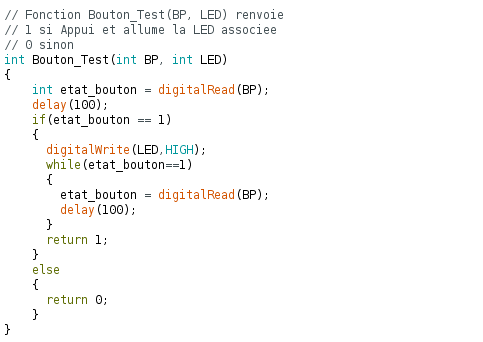
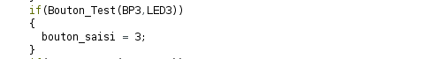
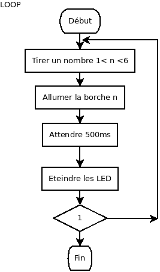

!!! info
    Nous disposons actuellement d'un programme (téléchargeable [ici](simon_foncitons5.ino)) permettant d'allumer une LED lorsque le bouton qui lui est associé est actionné. Notons un changement au niveau de la fonction **Bouton_Test(Bouton, LED) :**

    

    En effet cette fonction prend désormais deux paramètres d'entrée :

    - **BP** : Le bouton poussoir à tester
    - **LED** : La LED à allumer si le bouton poussoir est actionné

    Elle renvoie toujours une valeur en sortie pour indiquer :

    - **1 :** Le bouton a été actionné
    - **0** : Le bouton n'a pas été actionné

    L''appel se fait donc de la manière suivante (voir fonction **Scan_Bouton()**) :

    

    Ici si la fonction **Bouton_Test(BP3, LED3)** renvoie 1, alors le code entre accolades est exécuté.

## Séquence aléatoire

Le nouveau programme doit désormais jouter une séquence de notes aléatoires suivant l'algorigramme suivant :

!!! consigne
    A l'aide de la section précédente sur la fonction random, modifier la fonction loop() en conséquence.

!!! info
    Lire la documentation de la fonction random disponible sur [https://www.arduino.cc/reference/en/language/functions/random-numbers/random/](https://www.arduino.cc/reference/en/language/functions/random-numbers/random/).

    !!! consigne
        D'après la documentation, que réalise cette fonction ?

    <!-- zone: 4 -->

    !!! consigne
        Quelle est sa syntaxe ?

    <!-- zone: 4 -->

    !!! consigne
        Quel est le type de variable renvoyé en sortie ?

    <!-- zone: 1 -->

    !!! consigne
        En théorie quelle est la valeur min et la valeur max d'un **int**

    <!-- zone: 2 -->

    !!! consigne
        En théorie quelle est la valeur min et la valeur max d'un **long**

    <!-- zone: 2 -->

    !!! consigne
        Tester l'exemple de la documentation.

        - Qu'observe-t-on ?

    <!-- zone: 2 -->

    !!! consigne
        En commentant la ligne " **randomSeed(analogRead(0));**", exécuter plusieurs fois le programme (en appuyant sur le bouton reset).

        - Qu'observe-t-on ?

    <!-- zone: 3 -->

    !!! consigne
        En lisant la documentation, que réalise la fonction **randomSeed** ?

    <!-- zone: 10 -->
