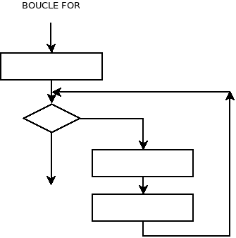
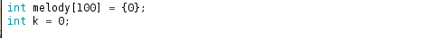
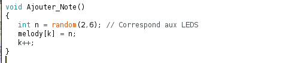
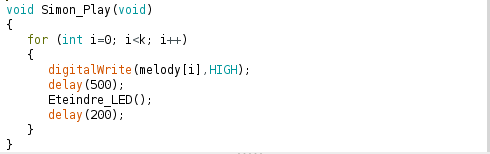

!!! info
    On rappelle ici que le jeu répète la même couleur et le même son, puis ajoute au hasard une nouvelle couleur. Il faut donc que le jeu "garde en mémoire" la séquence qu'il joue pour la rejouer au prochain tour et ajouter une note. Cette séquence peut être stockée dans un tableau (Array en anglais) contenant des variables (de type **int**).

    !!! consigne
        Lire la documentation sur les tableaux [http://www.mon-club-elec.fr/pmwiki_reference_arduino/pmwiki.php?n=Main.Tableaux](http://www.mon-club-elec.fr/pmwiki_reference_arduino/pmwiki.php?n=Main.Tableaux)

    !!! consigne
        Tester les différents exemples sur les tableaux.

    !!! consigne
        Réaliser l'algorithme correspondant à la boucle **for** ci dessous :

    

## Jeu Simon

!!! info
    Dans notre dernier programme nous allons insérer un tableau représentant la séquence de notes :

    

    Après la fonction loop on rajoute une fonction permettant d'ajouter une note à la séquence :

    

    Et une fonction permettant de jouer la séquence :

    

    !!! consigne
        Réaliser l'algorithme de la fonction **Simon_Play()**

    <!-- zone: 20 -->
