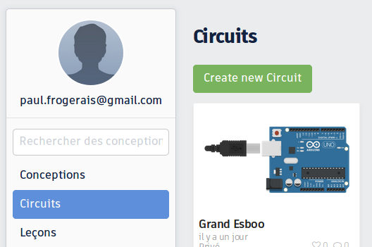
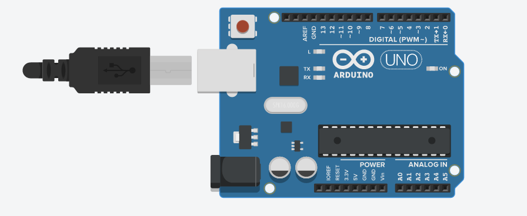
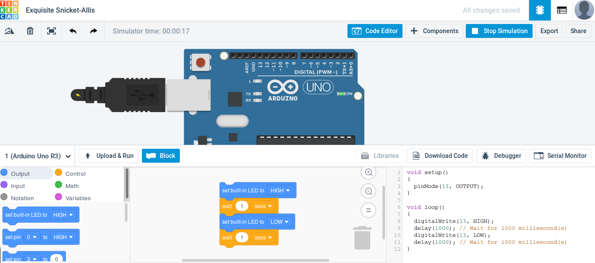
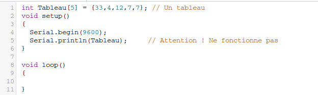
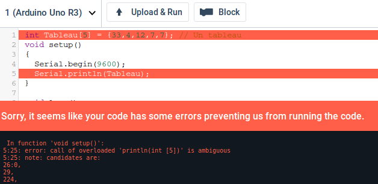
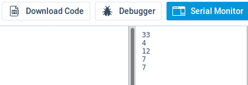
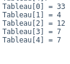
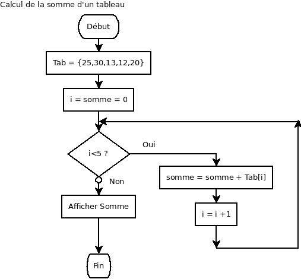
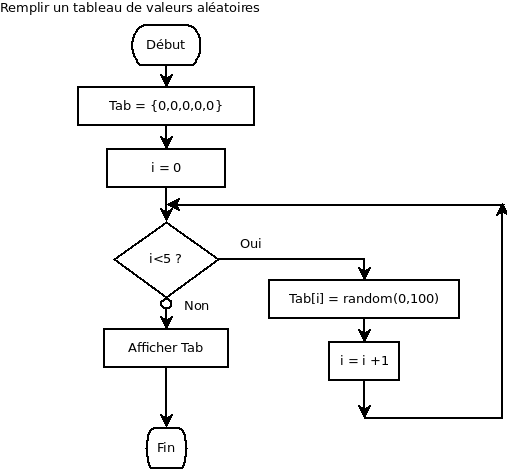

!!! info
    Grâce à la plate-forme de simulation en ligne de cartes Arduino : TinkerCAD vous allez réaliser différents programmes qui mettent en œuvre des tableaux.

    !!! consigne
        Créer un nouveau circuit

    

    !!! consigne
        Ajouter le seul composant utilisé dans cette activité : une carte Arduino

    

    <!-- zone: 4 -->

    !!! consigne
        Pour programmer la carte vous pouvez lancer l'éditeur en cliquant sur "Code Editor"

    

    !!! consigne
        Cliquer sur le bouton "Block" (surligné en bleu) pour se placer en mode normal (proche de l'IDE d'Arduino : écriture du programme en C++ ).

    Le premier programme qui apparaît est un simple Blink : Clignotement de la LED reliée à la **broche 13.**

    !!! consigne
        Téléverser le programme (Upload & Run) et vérifier que la LED associée clignote.

!!! warning
    Si vous souhaitez modifier le programme, il est nécessaire d'arrêter la simulation en cliquant sur **Stop Simulation**.

## Afficher le contenu d'un tableau

!!! info
    Dans l'environnement d'Arduino la fonction **Serial.println()** ne fonctionne pas avec les tableaux :

    

    

    <!-- zone: 8 -->

    Pour afficher le contenu au terminal série, il faut donc passer élément par élément dans une boucle.

    !!! consigne
        Modifier le programme ci-dessus en créant une boucle for pour afficher uniquement la valeur des éléments du tableau (voir cours).

    **NB** : Lors de la simulation, vous pouvez visualiser le Moniteur Série comme indiqué ci-contre :

    

    !!! consigne
        Modifier la programme pour permettre d'envoyer les indices et les valeur du tableau au terminal série. Le résultat doit suivre l'exemple **ci-contre.**

    

## Réaliser la somme des éléments d'un tableau

!!! info
    L'algorigramme suivant permet de calculer la somme d'un tableau :

    

    <!-- zone: 7 -->

    A chaque passage dans la boucle (itération) les variables **somme** et **i** changent.

    !!! consigne
        Après l’exécution de chaque itération compléter le tableau suivant :

        |   | valeur de **i** | Valeur de **somme** |
        |---|---|---|
        | Juste avant la boucle | 0 | 0 |
        | itération 1 | 1 |   |
        | itération 2 |   |   |
        | itération 3 |   |   |
        | itération 4 |   |   |
        | itération 5 |   |   |

    !!! consigne
        Créer un nouveau circuit et programmer la carte Arduino suivant l'algorigramme ci-dessus.

## Remplir un tableau de valeurs aléatoires

!!! info
    Après avoir initialisé les éléments du tableau à 0, on souhaite remplir ce tableau par de valeurs aléatoires comprises entre 0 et 99. Ceci peut être réaliser avec l'algorithme suivant :

    

    !!! consigne
        Créer un nouveau circuit sous TinkerCAD et programmer la carte suivant cet algorithme.
