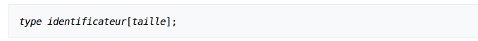
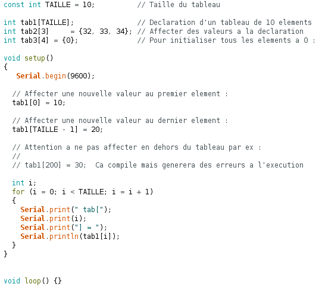

!!! info
    Wikipedia sur les [https://fr.wikibooks.org/wiki/Programmation_C%2B%2B/Les_tableaux](https://fr.wikibooks.org/wiki/Programmation_C%2B%2B/Les_tableaux) :" Les tableaux sont des structures de données constituées d'un certain nombre d'éléments de même type. On peut accéder directement à un élément du tableau en indiquant son indice entre crochets (indice de 0 à nombre_d_éléments-1)."

    Synthaxe :

    

    **Sémantique**

    `identificateur` est donc un tableau de `taille` éléments de type `type`. `taille` est obligatoirement une valeur constante. La taille du tableau est donc figée une fois pour toute et ne peut pas être modifiée en cours d'exécution.

    Pour désigner la **i-ième** case de tableau, on écrit

    identificateur\[i\]

    où i est un entier quelconque. Les cases sont numérotées à partir de 0 : les valeurs possibles de i vont donc de 0 à taille-1.

    [fiche mémo](tableaux_c.sozi.html)

    Un autre exemple ci-dessous montre les différentes méthodes pour déclarer un tableau :

    
