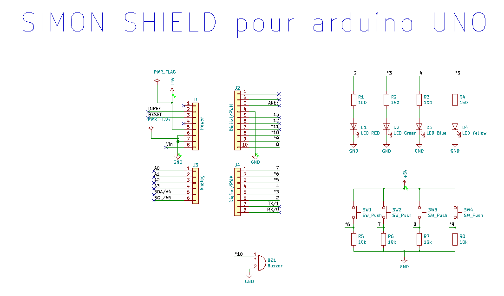
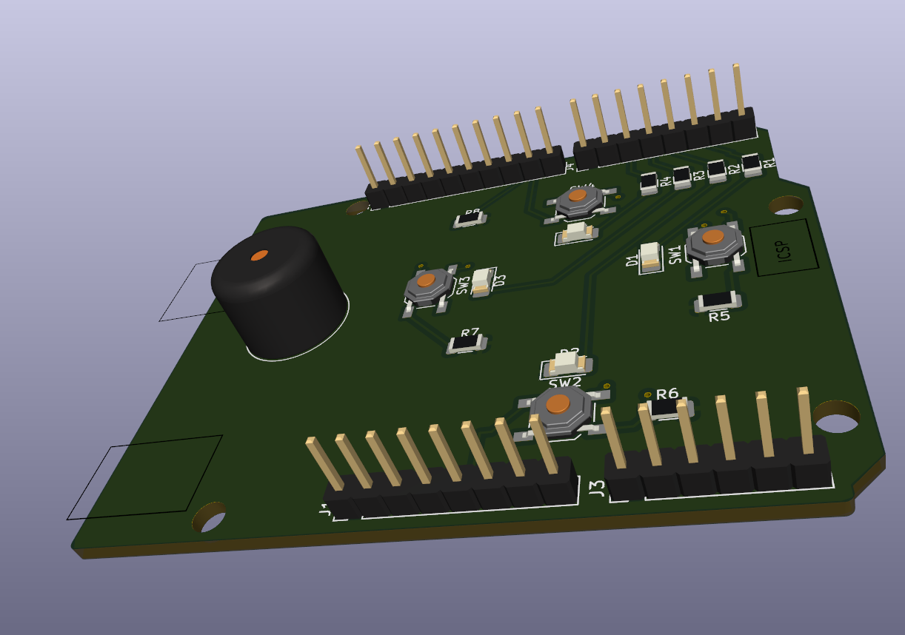
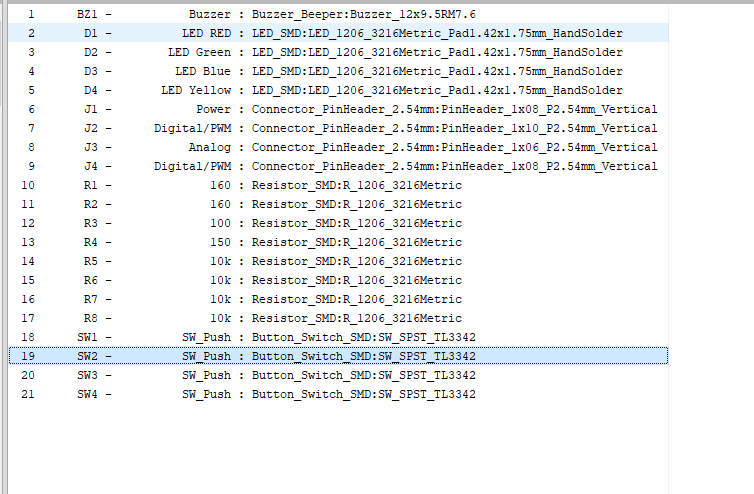

## Objectifs

Réaliser le schéma du shield Simon sous KiCAD :

Réaliser le circuit imprimé :

## KiCAD prise en main

[https://www.kicad.org/](https://www.kicad.org/) est un outil gratuit et open source d'utilisation pour la conception de circuits, la simulation de circuits et la conception de circuits imprimés.

!!! consigne
    Suivre le Tutoriel de [https://docs.kicad.org/8.0/en/getting_started_in_kicad/getting_started](https://docs.kicad.org/8.0/en/getting_started_in_kicad/getting_started) du logiciel

## Créer un nouveau projet

Association des empreinte :

!!! consigne
    Créer un nouveau projet nommé **SimonShield**

!!! consigne
    Reproduire le schéma puis le circuit imprimé (PCB).
